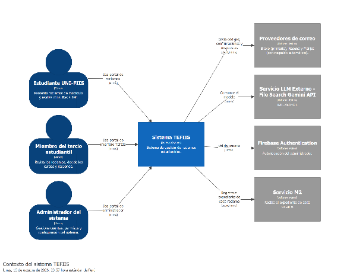
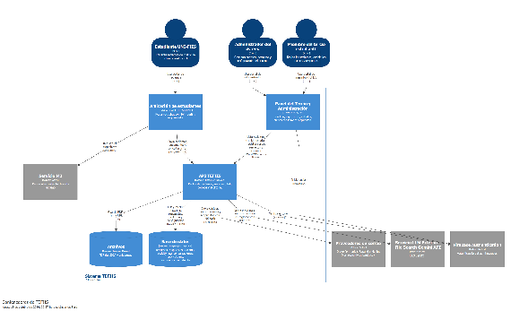
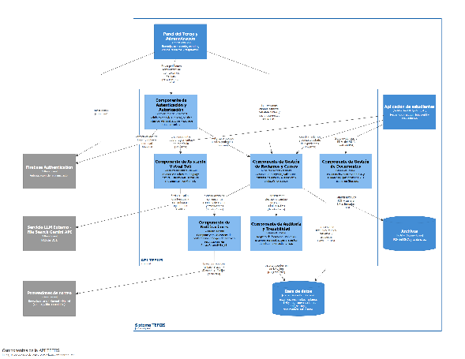
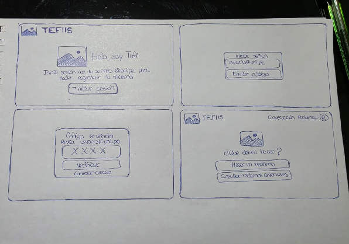
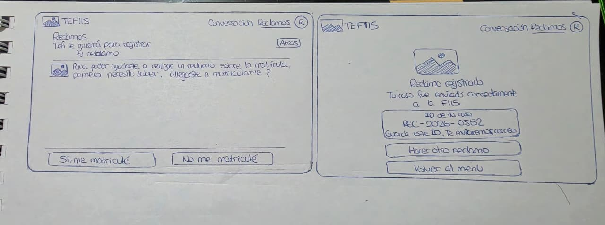
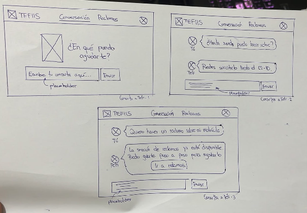

**UNIVERSIDAD NACIONAL DE INGENIERÍA**

Facultad de Ingeniería Industrial y de Sistemas

Escuela Profesional de Ingeniería de Software

**SW708 Arquitectura de Soluciones de Software**

Sección U

**Profesor: Elio Navarrete Vilca**

**Informe del proyecto integrador**

Entrega 1

**TEFIIS**: sistema de gestión de reclamos estudiantiles de la FIIS

**Equipo N.º 2**

| N.º | Apellidos y nombres | Código | Rol |
| :---- | :---- | :---- | :---- |
| 1 | Castro Aguirre, Lenin Giomar | 20240243J | Coordinador |
| 2 | Albino Soto, Christopher Henrry | 20231158C | Integrante |
| 3 | Nuñez Villazana, Franz Pool | 20244028F | Integrante |
| 4 | Puris Ricaldi, Roy Farid | 20244011F | Integrante |
| 5 | Rashuaman Sapallanay, Ricco Didier | 20231242D | Integrante |

| Repositorio | [https\://github.com/ricco-drs/sistema-reclamos](https://github.com/ricco-drs/sistema-reclamos) |
| :---- | :---- |
| **Commit revisado** | c42fa5d en la rama main |

Lima, octubre de 2026

**Registro de versiones**

| Versión | Fecha | Autor | Descripción de la modificación |
| ----- | :---- | :---- | :---- |
| 0.1 | 16/09/2026 | Rashuaman Sapallanay, Ricco Didier | Versión inicial del sistema en el repositorio, con la documentación del módulo M3: requisitos, atributos de calidad y bosquejo C4 (commit 9e1c20f). |
| 0.2 | 23/09/2026 | Nuñez Villazana, Franz Pool | Responsable de la Sección 3 (Modelo C4): codificación de workspace.dsl en Structurizr para los 3 niveles (Contexto, Contenedores y Componentes de la API TEFIIS), redacción de leyenda.md y exportación de las vistas SVG. |
| 0.3 | 09/10/2026 | Castro Aguirre, Lenin Giomar | Cuadro del costo del cambio (Lab04-05), rodaja de cursos resueltos por capas, ADR 001 y 002 (commit 506901e). |
| 0.4 | 14/10/2026 | Rashuaman Sapallanay, Ricco Didier | Puerto RepositorioCursosResueltos, adaptador en memoria, regla de arquitectura con dependency-cruiser e integración continua (commits da5ce5c a a6cd1e1). |
| 0.5 | 15/10/2026 | Rashuaman Sapallanay, Ricco Didier | Primer borrador del informe: escenarios reescritos sobre el código, modelo C4, ADR-0003, diseño de la interfaz y pendientes para P4. |
| 0.6 | 17/10/2026 | Albino Soto, Christopher Henrry | Ficha del sistema, escenarios de calidad, documentación de la interfaz y reorganización del repositorio en carpetas (sistema-reclamos/, sistema-admin/ y docs/). |
| 0.7 | 18/10/2026 | Puris Ricaldi, Roy Farid | Renombrado de los ADR a 0001 y 0002 y creación del ADR-0003 sobre la secuencia de PostgreSQL (PR \#3). |
| 0.8 | 19/10/2026 | Castro Aguirre, Lenin Giomar | Bitácora de las semanas 4 y 5, documentación de laboratorios, decisión sobre el corpus de Tefi y cierre de observaciones (PR \#9 y \#10). |
| 0.9 | 20/10/2026 | Puris Ricaldi, Roy Farid | Crítica cruzada del Equipo 3 aplicada a los escenarios, bitácora de IA, Lab07 (patrones, acoplamiento, bocetos y acta del recorrido), Servicio M2 restituido en el modelo C4 con los diagramas en modo claro (PR \#13) y cierre del informe. |
| 1.0 | 20/10/2026 | Castro Aguirre, Lenin Giomar | Versión que se entrega (commit c42fa5d). |

**Contenido**

[1\. Resumen	4](#1.-resumen)

[2\. Escenarios de calidad	6](#2.-escenarios-de-calidad)

[2.1 Priorización	10](#2.1-priorización)

[2.2 Crítica cruzada	11](#2.2-crítica-cruzada)

[2.3 Antes y después de los escenarios	13](#2.3-antes-y-después-de-los-escenarios)

[3\. Modelo C4	14](#3.-modelo-c4)

[3.1 Contexto	14](#3.1-contexto)

[3.2 Contenedores	15](#3.2-contenedores)

[3.3 Componentes del módulo	16](#3.3-componentes-del-módulo)

[3.4 Fuente: workspace.dsl	16](#3.4-fuente:-workspace.dsl)

[4\. Decisiones de arquitectura	19](#4.-decisiones-de-arquitectura)

[ADR-0001. Una sola API, con la rodaja separada por capas, en lugar de un microservicio	19](#adr-0001.-una-sola-api,-con-la-rodaja-separada-por-capas,-en-lugar-de-un-microservicio)

[ADR-0002. Puerto RepositorioCursosResueltos con dos adaptadores intercambiables	20](#adr-0002.-puerto-repositoriocursosresueltos-con-dos-adaptadores-intercambiables)

[ADR-0003. La numeración de los reclamos la garantiza una secuencia de PostgreSQL, no la API	21](#adr-0003.-la-numeración-de-los-reclamos-la-garantiza-una-secuencia-de-postgresql,-no-la-api)

[5\. Diseño de la interfaz	23](#5.-diseño-de-la-interfaz)

[5.1 Flujos principales	23](#5.1-flujos-principales)

[5.2 Frontera entre la interfaz y el dominio	23](#5.2-frontera-entre-la-interfaz-y-el-dominio)

[5.3 Bocetos y recorrido cognitivo	24](#5.3-bocetos-y-recorrido-cognitivo)

[6\. Rodaja vertical	27](#6.-rodaja-vertical)

[6.1 Estructura de paquetes	27](#6.1-estructura-de-paquetes)

[6.2 Dominio	27](#6.2-dominio)

[6.3 Puerto de salida	28](#6.3-puerto-de-salida)

[6.4 Caso de uso	28](#6.4-caso-de-uso)

[6.5 Prueba de dominio	29](#6.5-prueba-de-dominio)

[6.6 Reglas de arquitectura	29](#6.6-reglas-de-arquitectura)

[6.7 Integración continua	30](#6.7-integración-continua)

[6.8 Evidencia	31](#6.8-evidencia)

[7\. Bitácora de uso de IA	32](#7.-bitácora-de-uso-de-ia)

[8\. Lo que falta para P4	34](#8.-lo-que-falta-para-p4)

[Anexo: rúbrica	36](#anexo:-rúbrica)

# **1\. Resumen** {#1.-resumen}

TEFIIS es la plataforma web con la que la Facultad de Ingeniería Industrial y de Sistemas de la UNI recibe y resuelve los reclamos de matrícula de sus estudiantes. El estudiante entra con su correo @uni.pe y un código de cuatro dígitos, sube su ficha académica, su avance curricular y, si la tiene, su boleta de matrícula del SIGA, elige los cursos y secciones que quiere retirar o matricular y envía el reclamo. Recibe un número de caso con la forma REC-2026-NNNN y sigue su estado desde la misma aplicación. Los miembros del Tercio, que atienden los reclamos en la facultad, los revisan desde un panel propio: cambian su estado, deciden qué cursos-sección se matriculan o se retiran de verdad y responden al estudiante por correo. El sistema incluye a Tefi, un asistente conversacional que responde dudas sobre reglamentos y trámites buscando en los documentos oficiales de la facultad (RAG con Gemini).

**De dónde viene.** Es la opción A del enunciado: un sistema propio del equipo, desarrollado en el curso de Diseño de Software desde el 15/04/2026 por Christopher Albino y Ricco Rashuaman, y traído a este repositorio el 16/09/2026, que ya está en uso. La API corre en Railway, la aplicación de estudiantes se sirve desde Cloudflare Workers y, cuando se creó la secuencia que numera los reclamos, la numeración de 2026 ya iba en REC-2026-0366. Tiene base de datos (PostgreSQL en Supabase), entidades relacionadas (reclamos, respuestas enviadas, documentos del estudiante, conversaciones con Tefi y registro de actividad) y reglas de negocio que se pueden romper: la ventana de reclamos abierta o cerrada, los seis estados de un reclamo con MATRICULADO como estado final, los cursos que deben existir en el catálogo y los reclamos repetidos que no deben duplicarse.

**Trabajo de este ciclo.** Los documentos de arquitectura, la rodaja de cursos resueltos (primero por capas en el Lab04-05 y después en puertos y adaptadores en el Lab06), el adaptador en memoria, la regla de arquitectura con dependency-cruiser y la integración continua en GitHub Actions. El resto del código es anterior al ciclo.

**Qué contiene esta entrega, en este orden.**

* Seis escenarios de calidad reescritos sobre el comportamiento real del código, cada uno con su instrumento de medida, y su priorización (sección 2).

* El modelo C4 en tres niveles: contexto, contenedores y componentes de la rodaja, con la fuente en Structurizr DSL (sección 3).

* Tres ADR: una sola API con la rodaja separada por capas, el puerto de persistencia con dos adaptadores y la secuencia de PostgreSQL que numera los reclamos (sección 4).

* Los tres flujos principales y la frontera entre lo que valida la interfaz y lo que valida el dominio (sección 5).

* La rodaja vertical de extremo a extremo, con su código, sus 12 pruebas, la regla de arquitectura y la integración continua (sección 6).

* La bitácora de uso de IA (sección 7\) y Lo que falta para P4, con su riesgo (sección 8).

**Capacidad elegida para la rodaja: registrar los cursos resueltos de un reclamo.** Es la decisión del Tercio sobre qué cursos-sección se matriculan y cuáles se retiran de verdad, que no tiene por qué coincidir con lo que pidió el estudiante. La elegimos por tres razones: es la decisión que más pesa para el estudiante; tenía reglas reales (máximo de cursos por lista, normalización de código y sección, historial con autor y fecha) mezcladas con HTTP, PostgREST y auditoría dentro de backend/​server.js; y era lo bastante pequeña para aislarla sin cambiar el contrato HTTP que usa el panel ni el esquema de la base de datos.

Tabla 1.1. Integrantes del equipo

| Apellidos y nombres | Código | De qué fue responsable |
| :---- | :---- | :---- |
| Castro Aguirre, Lenin Giomar | 20240243J | Coordinación de la entrega. Lab04-05: cuadro del costo del cambio, rodaja por capas, ADR 001 y 002\. Documentación de laboratorios y cierre de observaciones (PR \#9 y \#10). |
| Albino Soto, Christopher Henrry | 20231158C | Autor de la documentación del módulo M3 (requisitos, atributos de calidad y bosquejo C4), base de las secciones 2 y 3\. En este ciclo reorganizó el repositorio en carpetas (sistema-reclamos/, sistema-admin/ y docs/), agregó la ficha del sistema, los escenarios y la documentación de la interfaz, e integró los diagramas C4. |
| Nuñez Villazana, Franz Pool | 20244028F | Responsable de la Sección 3 (Modelo C4): codificación de workspace.dsl en Structurizr para los 3 niveles (Contexto, Contenedores y Componentes de la API TEFIIS), redacción de leyenda.md y exportación de las vistas SVG. |
| Puris Ricaldi, Roy Farid | 20244011F | Redactó los ADR de la entrega: renombrado a 0001 y 0002 con el texto de la sección 4, y creó el ADR-0003 sobre la secuencia de PostgreSQL, con sus     consecuencias.  |
| Rashuaman Sapallanay, Ricco Didier | 20231242D | Lab06: puerto RepositorioCursosResueltos, adaptador en memoria, regla de dependency-cruiser e integración continua. Antes del curso, desarrollo principal de la API y de la aplicación de estudiantes, y despliegue. |

Tabla 1.2. Datos de la entrega

| Repositorio | [https\://github.com/ricco-drs/sistema-reclamos](https://github.com/ricco-drs/sistema-reclamos) |
| :---- | :---- |
| **Commit revisado** | c42fa5d: https\://github.com/ricco-drs/sistema-reclamos/commit/c42fa5dce953173431da08a21ab79489c12aef38. Es el último commit de main antes de agregar este informe en docs/arquitectura.md. |
| **Lenguaje y stack** | JavaScript (Node.js 22, Express 5\) en la API; TypeScript, React 19 y Vite en la aplicación web; PostgreSQL y Storage en Supabase; Firebase Authentication para el panel; Gemini para Tefi. |
| **Estado del build** | En verde en el commit c42fa5d: 12 pruebas pasan y la regla de arquitectura no encuentra violaciones (corrida de GitHub Actions del 20/10/2026): https\://github.com/ricco-drs/sistema-reclamos/actions/runs/39378679897 |
| **Comando para construir** | git clone https:/​/​github.com/​ricco-drs/​sistema-reclamos.git cd sistema-reclamos npm ci && npm test && npm run arch:check |

# **2\. Escenarios de calidad** {#2.-escenarios-de-calidad}

Partimos de los cinco escenarios del módulo M3 que ya estaban en el repositorio (docs/atributos\_calidad\_M3.md). Al contrastarlos con el código encontramos que varios describen un sistema que no existe: el correo no sale por un servidor SMTP institucional sino por tres proveedores con API HTTP, no hay reintentos cada cinco minutos y no hay asignación automática de casos. Los reescribimos sobre el comportamiento real y agregamos a cada medida el instrumento con que se comprueba. Después los sometimos a la crítica cruzada del Equipo 3 (sección 2.2) y corregimos lo que no resistió; los escenarios de abajo son la versión ya corregida y la sección 2.3 muestra qué cambió. La regla que nos dimos: si no sabemos con qué herramienta se va a medir, y quién la va a correr, el escenario no está terminado. Los escenarios de carga y de resiliencia se ejecutan contra el entorno de Docker Compose de la semana 11, nunca contra producción.

Tabla 2.1. Escenario de disponibilidad: cierre del plazo de reclamos (E1)

| Fuente | 200 estudiantes de la FIIS en la última hora del plazo de reclamos de matrícula, muchos desde la red de la UNI y con una sola IP pública. |
| :---- | :---- |
| **Estímulo** | Envían su reclamo casi al mismo tiempo. El 10 % (20 estudiantes) lo envía dos veces a la vez, por un doble clic o porque la red falló. |
| **Artefacto** | Ruta POST /​api/​reclamos de la API, función siguiente\_​id\_​reclamo() y tabla reclamos en PostgreSQL. |
| **Entorno** | Docker Compose con PostgreSQL y PostgREST, una sola instancia de la API, ventana de reclamos abierta, sin Firebase ni proveedores reales de correo. Nunca producción. |
| **Respuesta** | Cada reclamo recibe un número único REC-2026-NNNN y queda guardado. Un reenvío idéntico del mismo estudiante dentro de 10 minutos devuelve el número ya asignado en lugar de crear otro reclamo. Si no se logra asignar un número tras 10 intentos, la API responde 503 con un mensaje que invita a reintentar. |
| **Medida** | Perdido: un reclamo que la API respondió con su número y que no existe en la tabla reclamos; la meta es 0\. 503: se cuenta aparte; no es un reclamo perdido porque la API lo rechazó de forma explícita y el estudiante puede reintentar, pero entra en el límite de menos del 1 % de respuestas 5xx. k6 no reintenta un 503\. Números repetidos: 0 entre los que recibió k6. Duplicados por reenvío: 0 filas con el mismo estudiante y la misma descripción, con los reenvíos enviados al mismo tiempo. Instrumento. k6, 200 usuarios virtuales durante 5 minutos. Los 200 tokens de estudiante los genera un script de preparación (pruebas/generar-tokens.js, por crear) que firma 200 JWT con { email } y el JWT\_SECRET de Compose: la sesión del estudiante la firma la propia API, así que no hace falta Firebase. Los reenvíos salen en un mismo http.batch. k6 exporta a un archivo, con handleSummary, cada número recibido junto con el correo de prueba. Una consulta SQL comprueba que cada número del archivo exista en reclamos y busca filas repetidas por correo y descripción. Lo corre quien arma Compose, en la semana 12, y deja el resultado en docs/mediciones/e1.md. |

Tabla 2.2. Escenario de rendimiento: bandeja del panel del Tercio (E2)

| Fuente | Hasta 10 miembros del Tercio a la vez. |
| :---- | :---- |
| **Estímulo** | Abren o recargan la bandeja de reclamos del panel. |
| **Artefacto** | Ruta GET /​api/​admin/​reclamos y tabla reclamos. |
| **Entorno** | Docker Compose con PostgreSQL y PostgREST (sin PostgREST nunca aparece el corte de 1 000 filas), con 1 500 reclamos de ejemplo con nombres y correos ficticios. |
| **Respuesta** | El panel recibe todos los reclamos, sin que falte ninguno. |
| **Medida** | Latencia p95 menor a 1,5 s y 0 reclamos faltantes: el total listado coincide con count(\*) de la tabla. Instrumento. k6, 10 usuarios virtuales durante 3 minutos. Los 1 500 reclamos los siembra scripts/sembrar-reclamos.js (por crear), que mantiene quien arma Compose. Primero se mide la bandeja tal como está, que es la línea base, anotando la máquina (procesador y memoria) en el resultado; la meta de 1,5 s se compara contra esa línea. Después se aplica una sola mejora, paginar la bandeja, y se mide de nuevo en la misma máquina. Lo corre quien arma Compose, en la semana 12, y deja el resultado en docs/mediciones/e2.md. Con 1 500 reclamos y PostgREST se espera ver faltantes antes de paginar, porque PostgREST corta las respuestas en 1 000 filas. |

Tabla 2.3. Escenario de seguridad: acceso a reclamos ajenos (E3)

| Fuente | Un estudiante con sesión válida, o una cuenta del panel configurada como de solo lectura; también quien no trae token, trae uno vencido o uno falsificado. |
| :---- | :---- |
| **Estímulo** | Pide el detalle de un reclamo que no es suyo o adjunta la evidencia de otro estudiante; una cuenta de solo lectura intenta cambiar el estado de un reclamo; alguien manda en el cuerpo un correo distinto del de su sesión. |
| **Artefacto** | Middlewares requireStudentAuth y requireAdminAuth, y las consultas filtradas por el correo de la sesión, en backend/​server.js. |
| **Entorno** | Operación normal, con la suite corriendo sin credenciales reales. |
| **Respuesta** | Se rechaza la operación sin revelar datos: 401 sin token, vencido o falsificado; 404 para el reclamo ajeno, sin distinguir entre «no existe» y «no es tuyo»; 403 para la evidencia ajena y para cualquier escritura desde una cuenta de solo lectura. El correo que decide de quién son los datos sale siempre del token, nunca del cuerpo de la petición. |
| **Medida** | 100 % de las combinaciones de la matriz con el código esperado, y 0 campos del reclamo ajeno en el cuerpo de cualquier respuesta rechazada. La matriz tiene 26 casos: las rutas de estudiante GET /api/reclamos/mine/:id y POST /api/reclamos, por los actores sin token, vencido, falsificado, dueño y ajeno (10 casos; en POST /api/reclamos el «ajeno» es una evidencia adjunta que pertenece a otro estudiante, que es donde la API responde 403, y el «dueño» una evidencia propia); las rutas de admin PATCH /api/admin/reclamos/:id, PUT /api/admin/reclamos/:id/cursos-resueltos y POST /api/admin/reclamos/:id/responder, por los actores sin token, vencido, falsificado, solo lectura y escritura (15 casos); y un caso en que el cuerpo trae un correo distinto del de la sesión (1 caso). Instrumento. Suite en node:test. Los tokens de estudiante se firman con un JWT\_SECRET de prueba; los de admin los resuelve un verificador falso que se inyecta en lugar de Firebase. Ese verificador tiene que dejar firebaseReady en verdadero, porque si no requireAdminAuth responde 500 antes de mirar el token; además, las cuentas de prueba tienen que figurar en ADMIN\_EMAILS, y la de solo lectura también en ADMIN\_EMAILS\_SOLO\_LECTURA. «0 campos ajenos» se comprueba buscando en el cuerpo de la respuesta los datos del otro estudiante. La corre CI en cada push. Para que la suite pueda importar la aplicación hace falta exportar app, separar el arranque e inyectar el verificador; ese cambio se hace en la semana 10, junto con la suite. |

Tabla 2.4. Escenario de modificabilidad: cambiar una regla de cursos resueltos (E4)

| Fuente | El Tercio. |
| :---- | :---- |
| **Estímulo** | Pide cambiar una regla de los cursos resueltos; el caso que se ensaya es conservar 100 entradas de historial en lugar de 50\. |
| **Artefacto** | Dominio de la rodaja: backend/​dominio/​cursosResueltos.js y sus pruebas. |
| **Entorno** | Tiempo de desarrollo, con el sistema en producción. |
| **Respuesta** | El cambio se hace en el dominio y se prueba sin Supabase, sin Firebase y sin credenciales. No cambian el adaptador, el handler, el contrato HTTP ni el panel. |
| **Medida** | En el simulacro, 0 archivos modificados fuera de backend/dominio/ y backend/tests/. Como dato de apoyo, npm test en verde con las variables de entorno vacías. Instrumento. Simulacro: un integrante abre una rama que no se fusiona, cambia slice(-49) por slice(-99) en backend/dominio/cursosResueltos.js (línea 21\) y ajusta la prueba que cuenta las entradas del historial, y corre git diff \--stat contra main. En el código no hay un 50 escrito: el historial conserva las 49 entradas anteriores más la nueva, y por eso el cambio es de \-49 a \-99. Se hace una vez, antes de la semana 9, y el resultado se anota en docs/mediciones/e4.md. Regla de arquitectura: dominio-limpio, escrita con dependency-cruiser en .dependency-cruiser.cjs y activa en CI con npm run arch:check. «Sin red» se comprueba corriendo las pruebas con SUPABASE\_URL y las demás credenciales vacías: si pasan, no usan red. |

Tabla 2.5. Escenario de confiabilidad: falla del proveedor de correo (E5)

| Fuente | Brevo, el proveedor principal de correo, deja de aceptar envíos: clave inválida (401), cuota del día agotada (429) o respuesta lenta. |
| :---- | :---- |
| **Estímulo** | El sistema debe enviar un código de verificación, la confirmación de un reclamo o la respuesta del Tercio. |
| **Artefacto** | Función sendEmail de la API, con la cadena de proveedores Brevo, Resend y Mailjet. |
| **Entorno** | Docker Compose con un servidor falso que imita las tres APIs de correo y se puede poner en modo correcto, 401, 429 o lento. No se llama a ningún proveedor real, así que no se gasta cuota ni se toca producción. |
| **Respuesta** | El correo sale por el siguiente proveedor disponible sin que nadie intervenga. Si fallan los tres, la API responde con error y el panel lo muestra. La respuesta al estudiante solo queda en el historial (respuestas\_​reclamo) si el correo salió. |
| **Medida** | Con Brevo en cada modo de falla, los 100 envíos de la corrida son aceptados por otro proveedor. El servidor falso cuenta las llamadas a cada proveedor: 100 intentos a Brevo y 100 a Resend, y 0 a Mailjet. 0 respuestas en el historial sin correo enviado. La demora adicional se mide, pero solo es comparable para 401 y 429, que responden de inmediato. Instrumento. Un script envía los 100 correos contra la API en Compose, y el conteo sale del registro del servidor falso. Los 100 envíos van a correos de destino distintos, porque las rutas que mandan códigos y confirmaciones tienen un límite de 5 por correo cada 15 minutos (limiteEnvioCodigo) y con un solo destinatario se chocaría con él. Lo corre quien arma Compose, en la semana 11, y deja el resultado en docs/mediciones/e5.md. El modo lento hoy debe fallar: sendEmail no tiene timeout, así que una respuesta lenta deja la petición colgada; ese resultado es el hallazgo que justifica agregarlo. Para que el servidor falso reciba las llamadas hace falta un cambio previo: las URL de los tres proveedores están escritas en server.js y tienen que poder configurarse. |

Tabla 2.6. Escenario de auditabilidad: quién decidió y cuándo (E6)

| Fuente | La coordinación de la facultad, o un estudiante que cuestiona una decisión. |
| :---- | :---- |
| **Estímulo** | Pregunta quién decidió matricular o retirar un curso-sección de un reclamo, quién cambió su estado y cuándo. |
| **Artefacto** | Historial dentro de la columna reclamos.cursos\_​resueltos, tabla activity\_​log y tabla respuestas\_​reclamo. |
| **Entorno** | Docker Compose con PostgreSQL, nunca producción. |
| **Respuesta** | Cada decisión sobre cursos, cada cambio de estado y cada respuesta enviada queda registrada con su autor, tomado del token verificado y no del cuerpo de la petición, y con su fecha y detalle. Un reclamo en estado MATRICULADO ya no puede cambiar de estado (409). |
| **Medida** | El denominador son las decisiones que la propia prueba ejecuta: 30 cambios de estado, 30 guardados de cursos resueltos (con altas y bajas) y 30 respuestas, 90 en total. 100 % de ellas con autor y fecha, y el autor coincide con la identidad autenticada aunque el cuerpo diga otra. Instrumento. La prueba HTTP existente (comunica resultado y registra auditoría con identidad autenticada), ampliada a los tres tipos de decisión y corriendo en CI. Después, una consulta SQL sobre activity\_log en Compose cruza las 90 decisiones que la prueba sabe que ejecutó con las filas encontradas, para detectar las que faltan. Lo corre quien arma Compose, en la semana 11, y deja el resultado en docs/mediciones/e6.md. Riesgo conocido: logActividad no espera ni reintenta, así que si Supabase falla en ese instante la decisión se guarda pero su registro se pierde; la corrida incluye un caso con esa falla inyectada y hoy se espera que muestre filas faltantes, por lo que E6 no se declara cumplido todavía. |

## **2.1 Priorización** {#2.1-priorización}

Puntuamos cada escenario por su impacto en el estudiante (qué pasa si no se cumple) y por su dificultad técnica (cuánto cuesta cumplirlo). La prioridad sale del impacto; la dificultad nos dice cuánto esfuerzo reservar.

Tabla 2.7. Priorización de los escenarios

| Escenario | Impacto | Dificultad | Prioridad | Decisión que lo atiende |
| :---- | :---- | :---- | ----- | :---- |
| E1 Disponibilidad | Alto | Alta | 1 | ADR-0003 (la secuencia de PostgreSQL numera los reclamos). |
| E4 Modificabilidad | Alto | Media | 2 | ADR-0001 y ADR-0002, vigilados por la regla dominio-limpio. |
| E6 Auditabilidad | Alto | Baja | 3 | ADR-0002: el caso de uso registra autor y fecha en el historial; el autor sale del token. |
| E3 Seguridad | Alto | Media | 4 | Controles existentes en requireStudentAuth y requireAdminAuth; la evidencia automatizada llega en la semana 10\. |
| E5 Confiabilidad | Medio | Baja | 5 | Cadena de proveedores de correo, anterior a este ciclo; se pone a prueba en la semana 11\. |
| E2 Rendimiento | Medio | Media | 6 | Se mide en la semana 12 antes de optimizar nada. |

Esa prioridad guió las decisiones. Perder un reclamo en el cierre de matrícula puede dejar a un estudiante sin sus cursos, así que E1 va primero y es el único escenario que justificó poner lógica en la base de datos: en el ADR-0003 aceptamos depender de una función de PostgreSQL a cambio de una numeración atómica. E4 va segundo porque es el que más frena al equipo: cualquier cambio de reglas pasaba por un archivo de 2 351 líneas y no se podía probar sin credenciales. Atenderlo motivó el ADR-0001 y el ADR-0002, y por él aceptamos más archivos y una composición manual. E6 casi no cuesta, porque los registros ya existían, y la rodaja lo refuerza al tomar el autor del token. E3 tiene impacto alto, pero sus controles ya funcionan en producción; lo que falta es la prueba automatizada. E5 y E2 se medirán antes de cambiar nada. La crítica del Equipo 3 no cambió el orden, pero sí el estado de dos escenarios: E4 y E6 dejaron de figurar como «ya se cumple» y pasan a «por medir», porque el simulacro de E4 no se había hecho y la pérdida de registros de E6 no se había puesto a prueba.

Cuatro riesgos que ya vemos y que las mediciones tienen que confirmar o descartar. E1: la comprobación de reenvíos lee primero y escribe después, pues busca un reclamo del mismo correo con la misma descripción en los últimos 10 minutos y, si no lo encuentra, inserta; si las dos peticiones de un doble clic llegan a la vez, las dos pueden no encontrar nada y crear dos reclamos. Por eso los reenvíos de la prueba salen simultáneos y se espera que la medida de duplicados falle hasta corregirlo. E2: la ruta del panel pide select=\* sin paginar, y el propio server.js documenta en sbRestTodo que PostgREST corta las respuestas en 1 000 filas sin avisar; con más de 1 000 reclamos el panel dejaría de mostrar los más antiguos, y por eso el entorno incluye PostgREST. E5: sendEmail no tiene timeout, así que un proveedor que responde lento deja la petición colgada en lugar de pasar al siguiente; el modo lento de la prueba tiene que mostrarlo. E6: logActividad no espera ni reintenta, así que si Supabase falla en ese instante la decisión se guarda pero su registro en activity\_log se pierde; el historial dentro de cursos\_resueltos, en cambio, se guarda junto con la decisión, y la corrida inyecta esa falla.

## **2.2 Crítica cruzada** {#2.2-crítica-cruzada}

Pregunta única para cada escenario: ¿con qué instrumento concreto se mide esto, y quién lo va a correr? El equipo revisor asignado fue el Equipo 3\. La tabla resume sus observaciones y la corrección que aplicamos; la columna «¿Pasa?» es su valoración, y el texto completo de cada observación está en docs/[escenarios.md](http://escenarios.md).  
Tabla 2.8. Crítica cruzada del Equipo 3 y corrección aplicada

| ID | Observación del Equipo 3 (resumida) | ¿Pasa? | Corrección aplicada |
| :---- | :---- | :---- | :---- |
| E1 | Falta cómo exportar los números REC recibidos y cruzarlos con las filas; faltan los 200 tokens de estudiante sin Firebase; no se dice que los reenvíos sean simultáneos; el 503 choca con «0 perdidos». | Sí, falta el cómo y el quién | handleSummary exporta cada número recibido y una consulta SQL lo cruza con las filas. Un script firma los 200 tokens con el JWT\_SECRET de Compose. Los reenvíos salen en un mismo http.batch. «Perdido» se define y el 503 se cuenta aparte, sin reintento. Lo corre quien arma Compose. |
| E2 | Los 1 500 reclamos no tienen script que los siembre; si Compose levanta solo PostgreSQL, el límite de 1 000 filas nunca aparece (falso verde); el umbral de 1,5 s no tiene línea base ni máquina, y «una sola mejora» no dice cuál. | Sí, entorno dudoso | scripts/sembrar-reclamos.js siembra los reclamos y lo mantiene quien arma Compose. El entorno incluye PostgREST. Se mide primero la línea base, anotando la máquina, y la única mejora es paginar la bandeja. |
| E3 | «Al menos 8 casos» no sale de ninguna lista; faltan token ausente, vencido y falsificado; ningún caso verifica que el correo salga del token; no se explica cómo se obtienen tokens sin credenciales reales ni cómo se comprueba «0 campos ajenos». | Sí | Matriz de 26 casos, ruta × actor, con los tres estados del token y el correo en el cuerpo. Tokens de estudiante firmados con un secreto de prueba y verificador falso inyectado para admin. «0 campos ajenos» se comprueba buscando en la respuesta los datos del otro estudiante. |
| E4 | dominio-limpio no se identifica como herramienta; el cambio sobre el que se mide no existe (hay que hacer el simulacro); «ya se cumple» se apoya en 12 pruebas en 0,07 s, que miden velocidad y no modificabilidad; la regla no detecta el límite de 40 duplicado; «sin red» no dice cómo se comprueba. | No del todo | dominio-limpio se identifica como regla de dependency-cruiser. La medida pasa a ser un simulacro de 50 a 100 entradas, que se hace una vez; los 12 casos quedan como dato de apoyo. Se verificó que el límite de 40 no está repetido fuera del dominio. «Sin red» se comprueba con las credenciales vacías. |
| E5 | «Buzón de prueba» no es una herramienta; no dice si Resend y Mailjet son reales (cuota y producción); una clave inválida da 401 inmediato y no equivale a caída ni a cuota agotada; falta el script de envío; depende de Compose, que se arma en la misma semana 11\. | Parcial | Servidor falso de las tres APIs, sin llamadas reales, con modos 401, 429 y lento. La medida principal pasa a ser el conteo de llamadas por proveedor; la demora solo se compara en 401 y 429\. Un script envía los 100 correos. La dependencia de Compose se reconoce más abajo. |
| E6 | «100 % de decisiones» no tiene denominador; una consulta sobre activity\_log no detecta filas que faltan; logActividad puede perder el registro y ninguna medida inyecta esa falla; no dice sobre qué base corre ni quién. | Parcial | El denominador son 90 decisiones que la propia prueba ejecuta (30 de cada tipo) y la consulta las cruza con activity\_log. Se agrega un caso con la falla inyectada. Corre sobre la base de Compose, nunca producción, y se quita «ya se cumple». |

Dependencia reconocida de la crítica a E5. E5 y E6 se miden en el entorno de Compose, que se arma en esa misma semana 11\. Si Compose se atrasa, esas dos mediciones se atrasan con él; E3 y E4 no dependen de Compose y se hacen antes.

## **2.3 Antes y después de los escenarios** {#2.3-antes-y-después-de-los-escenarios}

La tabla compara la versión que revisó el Equipo 3 con la que quedó después de aplicar su crítica.  
Tabla 2.9. Escenarios antes y después de la crítica cruzada

| Escenario | Antes de la crítica | Después de la crítica |
| :---- | :---- | :---- |
| E1 | k6 y consulta SQL sin explicar cómo se cruzan; reenvíos de un 10 % sin decir que son simultáneos; «0 perdidos» sin tratar el 503\. | Exportación con handleSummary y consulta de cruce; 200 tokens firmados con el secreto de prueba; reenvíos en un mismo http.batch; «perdido» definido y 503 contado aparte. |
| E2 | 1 500 reclamos «de ejemplo» sin script; umbral de 1,5 s sin línea base ni máquina. | Script de siembra, PostgREST en el entorno, línea base con la máquina anotada y una sola mejora: paginar la bandeja. |
| E3 | «Al menos 8 casos» sin lista; sin token ausente, vencido ni falsificado; sin explicar de dónde salen los tokens. | Matriz de 26 casos ruta × actor, con los tres estados del token y el correo en el cuerpo; verificador falso para el admin. |
| E4 | «Ya se cumple» con 12 pruebas en 0,07 s; herramienta de la regla sin nombrar; medida sobre un cambio que no existía. | Simulacro de 50 a 100 entradas, dependency-cruiser nombrado y estado «por medir». |
| E5 | «Buzón de prueba» sin herramienta; clave inválida que no equivale a caída ni a cuota; sin script de envío. | Servidor falso de las tres APIs con modos 401, 429 y lento; conteo de llamadas por proveedor; script de 100 envíos. |
| E6 | «100 % de decisiones» sin denominador; consulta que no detecta filas faltantes; «ya se cumple» pese al riesgo conocido. | 90 decisiones ejecutadas por la prueba como denominador, cruce con activity\_log, caso con la falla inyectada y «ya se cumple» retirado. |

# **3\. Modelo C4** {#3.-modelo-c4}

Los tres niveles se describen en docs/c4/workspace.dsl con Structurizr DSL (sección 3.4). Cada figura incluye solo lo que existe en el código revisado: los dos clientes del sistema (la aplicación de estudiantes y el panel, que vive en sistema-admin), los servicios externos con los que se comunican y, en el tercer nivel, los seis componentes de negocio de la API.

## **3.1 Contexto** {#3.1-contexto}

|  |
| :---: |

Figura 3.1. Diagrama de contexto de TEFIIS. Tres tipos de persona usan el sistema (el estudiante, el Tercio y el administrador); los cuatro sistemas externos son servicios ajenos a TEFIIS.

**Observación del equipo.** El estudiante y el Tercio entran por puertas distintas al mismo sistema y nunca comparten pantalla. Todo lo que sale de TEFIIS es un servicio de terceros: cada flecha hacia la derecha es una dependencia que puede fallar sin que el equipo pueda arreglarla, y de una de ellas nace E5. El correo le llega al estudiante a través de los proveedores; TEFIIS no tiene servidor de correo propio. El servicio M2 es el único externo que no se configura en la API: lo llama directamente la aplicación de estudiantes (figura 3.2).

## **3.2 Contenedores** {#3.2-contenedores}

|  |
| :---: |

Figura 3.2. Diagrama de contenedores de TEFIIS. Las dos aplicaciones web viven en repositorios distintos y hablan con una sola API.

**Observación del equipo.** Una sola API concentra las reglas: las dos aplicaciones web pueden validar la forma de los datos, pero lo que importa se vuelve a comprobar en el servidor, porque cualquiera con un token puede llamar a la API sin pasar por la interfaz. La base de datos y los archivos están en Supabase, pero la API los usa como dos contenedores distintos: PostgREST para las tablas y Storage para los PDF, que solo se entregan con URL firmadas. La aplicación de estudiantes llama directamente al servicio M2 sin pasar por la API; es la única integración que la API no controla y la revisaremos con el flujo por eventos (sección 8).

## **3.3 Componentes del módulo** {#3.3-componentes-del-módulo}

|  |
| :---: |

Figura 3.3. Componentes de la API TEFIIS: autenticación y autorización, reclamos y cursos, asistente Tefi, notificaciones, auditoría y documentos, con sus dependencias.

**Observación del equipo.** Estos seis componentes son fronteras lógicas, no archivos: en el código casi todos siguen dentro de un único archivo, server.js (más de 100 KB), y solo la rodaja de cursos resueltos está separada en backend/, con su puerto y sus adaptadores. El diagrama sirve de mapa para partir server.js en módulos (semana 9). Por ejemplo, requireAdminAuth y logActividad viven dentro de server.js y todavía no tienen archivo propio.

## **3.4 Fuente: workspace.dsl** {#3.4-fuente:-workspace.dsl}

La fuente de los tres diagramas es un solo archivo de Structurizr DSL. El modelo declara personas, sistemas, contenedores y componentes con sus relaciones etiquetadas; las vistas eligen qué mostrar en cada nivel. Las relaciones de contexto y de contenedores se declaran antes que las de componentes, y todas llevan un verbo y su protocolo.

| docs/c4/workspace.dsl workspace "TEFIIS" "Gestión de reclamos estudiantiles de la FIIS-UNI" {     model {         estudiante \= person "Estudiante UNI-FIIS" "Presenta reclamos de matrícula y realiza consultas a Tefi."         tercio \= person "Miembro del tercio estudiantil" "Revisa los reclamos, decide los cursos y responde."         admin \= person "Administrador del sistema" "Gestiona cuentas, permisos y configuración del sistema."         gemini \= softwareSystem "Servicio LLM Externo \- File Search Gemini API" "RAG del BOT." "Sistema externo"         correo \= softwareSystem "Proveedores de correo" "Brevo (primario), Resend y Mailjet (con respaldo automático)." "Sistema externo"         firebase \= softwareSystem "Firebase Authentication" "Autenticación del administrador." "Sistema externo"         m2 \= softwareSystem "Servicio M2" "Recibe el expediente de cada reclamo." "Sistema externo"         tefiis \= softwareSystem "Sistema TEFIIS" "Sistema de gestión de reclamos estudiantiles." {             spa \= container "Aplicación de estudiantes" "Reclamos, chat con Tefi, perfil y seguimiento." "React 19, TypeScript, Vite"             panel \= container "Panel del Tercio y Administración" "Bandeja, expediente, estados, cursos resueltos y respuestas." "React, Vite"             api \= container "API TEFIIS" "Reglas de reclamos, sesiones, Tefi, correos y auditoría." "Node.js 22, Express 5" {                 auth \= component "Componente de Autenticación y Autorización" "Valida tokens de Firebase, verifica listas de administradores y protege rutas privadas." "server.js (Middleware)"                 reclamos \= component "Componente de Gestión de Reclamos y Cursos" "Gestiona la recepción, validación, cambios de estado, evaluación y resolución de cursos." "server.js y backend/"                 tefi \= component "Componente de Asistente Virtual Tefi" "Atiende consultas en lenguaje natural usando RAG sobre los reglamentos con Gemini." "promptTefi.js y server.js"                 notificaciones \= component "Componente de Notificaciones" "Compone y envía correos de confirmación, códigos de acceso y resoluciones vía Brevo/Resend/Mailjet." "server.js"                 auditoria \= component "Componente de Auditoría y Trazabilidad" "Registra de forma inmutable las acciones administrativas y eventos del sistema en activity\_log." "server.js"                 documentos \= component "Componente de Gestión de Documentos" "Valida archivos PDF del SIGA y evidencias, gestionando URLs firmadas en Storage." "server.js"             }             bd \= container "Base de datos" "reclamos, respuestas\_reclamo, activity\_log, conversaciones, app\_settings, documentos\_estudiante." "PostgreSQL en Supabase" "Almacén de datos"             archivos \= container "Archivos" "PDF del SIGA y evidencias." "Supabase Storage" "Almacén de datos"         }         \# Contexto. Relaciones explícitas de nivel 1         estudiante \-\> tefiis "Usa portal de reclamos" "HTTPS"         tercio \-\> tefiis "Usa portal de miembro TEFIIS" "HTTPS"         admin \-\> tefiis "Usa portal de administrador" "HTTPS"         tefiis \-\> correo "Envía códigos, confirmaciones y respuestas" "JSON/HTTPS"         tefiis \-\> gemini "Consume el modelo" "HTTPS"         tefiis \-\> firebase "Valida usuario" "HTTPS"         tefiis \-\> m2 "Registra el expediente de cada reclamo" "JSON/HTTPS"         \# Contenedores.         estudiante \-\> spa "Usa portal de reclamos" "HTTPS"         tercio \-\> panel "Usa portal de miembro TEFIIS" "HTTPS"         admin \-\> panel "Usa portal de administrador" "HTTPS"         spa \-\> api "Envía reclamos, documentos y consultas a Tefi" "JSON/HTTPS, JWT"         spa \-\> m2 "Registra el expediente" "JSON/HTTPS"         panel \-\> firebase "Inicia sesión" "Firebase SDK"         panel \-\> api "Lista reclamos, cambia estados, registra cursos resueltos y responde" "JSON/HTTPS, token de Firebase"         api \-\> firebase "Verifica el token" "Admin SDK"         api \-\> gemini "Envía preguntas con búsqueda en los reglamentos" "JSON/HTTPS"         api \-\> correo "Envía códigos, confirmaciones y respuestas con fallback" "JSON/HTTPS"         api \-\> bd "Lee y escribe reclamos, respuestas, auditoría y configuración" "PostgREST/HTTPS"         api \-\> archivos "Guarda PDF y firma URL" "HTTPS"         \# Componentes de la API TEFIIS (Nivel 3).         spa \-\> reclamos "Registra reclamos y consulta estado de expedientes" "JSON/HTTPS"         spa \-\> tefi "Envía preguntas sobre reglamentos de matrícula" "JSON/HTTPS"         spa \-\> documentos "Sube evidencias y PDFs del SIGA" "Multipart/HTTPS"         panel \-\> auth "Envía peticiones administrativas con token de Firebase" "JSON/HTTPS, Bearer Token"         panel \-\> reclamos "Lista reclamos, cambia estados, resuelve cursos y envía respuestas" "JSON/HTTPS"         auth \-\> reclamos "Autoriza el acceso a rutas protegidas" "In-process"         reclamos \-\> notificaciones "Solicita envío de correos ante cambios de estado y resoluciones" "Llamada a función"         reclamos \-\> auditoria "Registra cada decisión y cambio de estado administrativo" "Llamada a función"         auth \-\> firebase "Verifica validez del token y obtiene identidad" "Admin SDK"         tefi \-\> gemini "Envía consultas con búsqueda semántica en reglamentos" "JSON/HTTPS"         notificaciones \-\> correo "Envía correos con fallback Brevo \-\> Resend \-\> Mailjet" "JSON/HTTPS"         reclamos \-\> bd "Lee y escribe reclamos, cursos resueltos y respuestas" "PostgREST/HTTPS"         auditoria \-\> bd "Inserta eventos en activity\_log" "PostgREST/HTTPS"         documentos \-\> archivos "Guarda archivos PDF y genera URLs firmadas" "HTTPS"     }        views {         systemContext tefiis "Contexto" {             title "Contexto del sistema TEFIIS"             include \*             autolayout lr         }         container tefiis "Contenedores" {             title "Contenedores de TEFIIS"             include \*             autolayout tb         }         component api "Componentes" {             title "Componentes de la API TEFIIS"             include \*             autolayout tb         }         styles {             element "Person" {                 shape person                 background \#08427b                 color \#ffffff             }             element "Software System" {                 background \#1168bd                 color \#ffffff             }             element "Container" {                 background \#438dd5                 color \#ffffff             }             element "Component" {                 background \#85bbf0                 color \#000000             }             element "Sistema externo" {                 background \#999999             }             element "Almacén de datos" {                 shape cylinder             }             element "Boundary" {                 color \#0b4884             }             relationship "Relationship" {                 style solid             }         }     } }  |
| :---- |

Cómo se generan las imágenes. Se pega docs/c4/workspace.dsl en playground.structurizr.com y se exporta cada vista como SVG a docs/c4/img/; para este informe se convirtieron a PNG.

# **4\. Decisiones de arquitectura** {#4.-decisiones-de-arquitectura}

Los tres registros viven en docs/​adr/​ con el formato de Nygard. Cada uno responde a una decisión que ya se ve en el código del commit revisado, y la sección indica dónde.

## **ADR-0001. Una sola API, con la rodaja separada por capas, en lugar de un microservicio** {#adr-0001.-una-sola-api,-con-la-rodaja-separada-por-capas,-en-lugar-de-un-microservicio}

| Estado | Aceptado, 09/10/2026. |
| :---- | :---- |
| **Archivo** | docs/​adr/​0001-separacion-por-capas-api.md |

### **Contexto**

TEFIIS tiene dos aplicaciones web, la de estudiantes (este repositorio) y el panel del Tercio (repositorio sistema-admin), que hablan con una sola API Express desplegada en Railway. Toda la lógica de esa API está en backend/​server.js: 2 351 líneas y 41 rutas en las que conviven HTTP, consultas a PostgREST, correo, autenticación y reglas de negocio. Las reglas de cursos resueltos estaban dentro de su endpoint, y para probarlas había que levantar el servidor con credenciales de Supabase y de Firebase. E4 pide poder cambiar una de esas reglas sin tocar la infraestructura. El equipo tiene cinco integrantes, un solo entorno de despliegue y quince semanas.

### **Decisión**

Mantener una sola API desplegable y, dentro de ella, separar la capacidad «registrar cursos resueltos» en cuatro carpetas: presentacion/​, aplicacion/​, dominio/​ e infraestructura/​. server.js solo compone los objetos (líneas 1207 a 1209).

### **Alternativas consideradas**

* **Dejar la lógica en el endpoint.** A favor: ningún archivo nuevo, y los cambios pequeños se hacen rápido. En contra: las reglas siguen mezcladas con el transporte y la base de datos, y E4 no se puede cumplir, porque probar una regla exige el servidor completo con credenciales.

* **Extraer un microservicio de cursos resueltos.** A favor: despliegue y escalado independientes. En contra: la capacidad comparte con la API la autenticación de Firebase, la tabla reclamos y el registro de actividad. Sumaría otro despliegue en Railway, otro juego de secretos y una llamada de red entre servicios, sin una necesidad de escala que lo justifique: la usan unos 10 miembros del Tercio.

### **Consecuencias**

* Las reglas se prueban sin servidor ni credenciales: 12 pruebas en menos de un segundo.

* El panel no cambió: la ruta y su contrato son los mismos.

* Hay más archivos, y una composición manual en server.js que alguien tiene que mantener.

* El refactor es parcial: las otras 40 rutas siguen en server.js con sbRest directo. La partición en módulos queda para la semana 9\.

## **ADR-0002. Puerto RepositorioCursosResueltos con dos adaptadores intercambiables** {#adr-0002.-puerto-repositoriocursosresueltos-con-dos-adaptadores-intercambiables}

| Estado | Aceptado, 09/10/2026. Actualizado el 14/10/2026 con el adaptador en memoria y la regla de arquitectura. |
| :---- | :---- |
| **Archivo** | docs/​adr/​0002-puerto-persistencia-cursos-resueltos.md |

### **Contexto**

El caso de uso necesita leer el valor actual de los cursos resueltos de un reclamo y guardar el nuevo, con un historial de hasta 50 entradas, el administrador autenticado como autor y una respuesta 404 si el reclamo no existe. El dato vive en la columna jsonb reclamos.cursos\_​resueltos y se accede por PostgREST con sbRest. Queremos que las pruebas del caso de uso no usen la red (E4), y el curso pide un dominio que no conozca la infraestructura, con dos adaptadores y una regla automática que lo vigile.

### **Decisión**

El dominio declara el puerto RepositorioCursosResueltos, con obtener(id) y guardar(id, valor), en backend/​dominio/​repositorioCursosResueltos.js. El caso de uso lo recibe por inyección, junto con un reloj. Hay dos adaptadores: repositorioCursosSupabase (producción, PostgREST) y repositorioCursosMemoria (pruebas y demostración). La regla dominio-limpio de dependency-cruiser, que corre en CI, impide que backend/​dominio importe infraestructura o presentación.

### **Alternativas consideradas**

* **Llamar a sbRest desde el caso de uso.** A favor: menos código y un solo lugar donde mirar. En contra: el caso de uso queda atado a PostgREST, cada prueba tiene que simular respuestas HTTP y cambiar de almacenamiento obliga a tocar las reglas.

* **Pasar a un ORM (Prisma o Drizzle) con una tabla de historial normalizada.** A favor: esquema explícito, transacciones y un historial que se consulta sin recorrer JSON. En contra: exige migrar esquema y datos en producción en plena matrícula, no resuelve por sí solo el acoplamiento (el ORM entraría igual al caso de uso) y excede la rodaja.

### **Consecuencias**

* En el caso de uso no importa nada de infraestructura, y la misma prueba corre contra los dos adaptadores.

* JavaScript no comprueba que un adaptador cumpla el puerto: el contrato es un @typedef de JSDoc y nada falla si un adaptador cambia la firma. La prueba que corre contra los dos adaptadores es la única red.

* El adaptador en memoria no reproduce PostgREST (errores de esquema, límite de filas), así que no reemplaza una prueba de integración.

* Leer y luego escribir el historial no es atómico: si dos miembros del Tercio guardan el mismo reclamo a la vez, una entrada puede perderse. Resolverlo requiere control de versión o una función SQL.

* La regla solo vigila que el dominio no importe infraestructura ni presentación. No impide que aplicacion/​ importe infraestructura, ni que el dominio importe paquetes de npm como express.

## **ADR-0003. La numeración de los reclamos la garantiza una secuencia de PostgreSQL, no la API** {#adr-0003.-la-numeración-de-los-reclamos-la-garantiza-una-secuencia-de-postgresql,-no-la-api}

| Estado | Aceptado. Registrado a posteriori: la decisión se tomó el 16/09/2026, cuando la secuencia ya figuraba en el commit inicial, y se documentó el 18/10/2026 porque atiende al escenario de mayor prioridad. Responsable: Puris Ricaldi, Roy Farid. |
| :---- | :---- |
| **Archivo** | docs/​adr/​0003-secuencia-para-numerar-reclamos.md |

### **Contexto**

Cada reclamo se identifica con un número REC-AAAA-NNNN. Ese número va en el correo de confirmación, el estudiante lo usa para seguir su caso y el Tercio para hablar de él. Antes se calculaba en la API leyendo el número más alto y sumando uno. En el cierre de matrícula, cuando muchos estudiantes envían a la vez, dos peticiones leían el mismo máximo: una fallaba por clave duplicada y reintentaba, y quedaban huecos. Además, al borrar el último reclamo su número quedaba libre y el siguiente lo heredaba junto con lo que colgaba de él; así apareció la respuesta de una prueba en el reclamo de otra estudiante. E1, el escenario de mayor prioridad, exige cero reclamos perdidos y cero números repetidos.

### **Decisión**

El número sale de la secuencia public.reclamos\_​numero, a través de la función siguiente\_​id\_​reclamo() (sql/​secuencia\_​reclamos.sql), que la API llama por RPC; la API solo le da formato. Si la secuencia no existe, la API vuelve al método anterior con hasta 10 reintentos (backend/​server.js, líneas 740 a 809). Un reenvío idéntico del mismo estudiante dentro de 10 minutos devuelve el reclamo que ya existe.

### **Alternativas consideradas**

* **Máximo más uno en la API, con reintentos ante el error 409\.** A favor: no toca la base de datos. En contra: sigue siendo una carrera, deja huecos y vuelve a usar los números de reclamos borrados.

* **UUID generado en la API.** A favor: no choca nunca y no necesita un viaje a la base. En contra: el número deja de ser legible y fácil de dictar, se pierden el orden y el formato que estudiantes y Tercio ya usan, y habría que mantener dos identificadores.

* **Columna identity como clave primaria.** A favor: atómica y estándar. En contra: cambia el tipo de la clave de texto a número y obliga a migrar reclamos, respuestas\_​reclamo.reclamo\_​id y los números ya comunicados a los estudiantes.

### **Consecuencias**

* nextval es atómico: dos peticiones nunca reciben el mismo número, y un número borrado no vuelve a ser usado.

* Se conserva el formato REC-AAAA-NNNN.

* La numeración puede tener huecos: un número consumido por una inserción fallida no regresa.

* La creación de reclamos todavía no está detrás de un puerto, y un adaptador en memoria tendría que simular la secuencia.

* La secuencia no se reinicia cada año: en el año 2027 los números seguirán desde donde quedaron en 2026, no desde 0001\.

# **5\. Diseño de la interfaz** {#5.-diseño-de-la-interfaz}

La interfaz se documenta, no se califica por su aspecto. Para los tres flujos que más se usan anotamos qué valida la interfaz y qué valida el dominio. La regla que seguimos: la interfaz valida la forma, para que el usuario no espere; el dominio valida el significado, porque cualquiera con un token puede llamar a la API sin pasar por la interfaz.

## **5.1 Flujos principales** {#5.1-flujos-principales}

Tabla 5.1. Flujos principales

| Flujo | Quién lo inicia | Pasos |
| :---- | :---- | :---- |
| Presentar un reclamo | Estudiante | 1. Pide un código con su correo @uni.pe y lo ingresa; recibe una sesión de 24 horas. 2. Sube su ficha académica y su avance curricular del SIGA (la boleta es opcional) y declara su código, nombre y especialidad. 3. Elige la categoría, los cursos y secciones a retirar o matricular desde el catálogo, escribe la descripción y adjunta un PDF de evidencia. 4. Envía. La API valida y devuelve el número REC-2026-NNNN. 5. Recibe la confirmación por correo y sigue el estado de su reclamo en la aplicación. |
| Consultar a Tefi | Estudiante, con sesión iniciada | 1. Inicia sesión con su correo @uni.pe (el chat no deja escribir antes) y escribe su pregunta. 2. La API la envía a Gemini con búsqueda en los reglamentos indexados. 3. Tefi responde con texto, tablas y fórmulas. 4. El turno se guarda para auditoría. Si el Tercio activó el modo almuerzo, la API responde 503 y la aplicación le ofrece registrar su reclamo. |
| Resolver un reclamo | Miembro del Tercio | 1. Inicia sesión en el panel con su cuenta de Firebase. 2. Abre el reclamo y revisa sus documentos, que se muestran con URL firmadas. 3. Cambia el estado: EN\_REVISION, ACEPTADO, ACEPTADO\_PARCIALMENTE, RECHAZADO o MATRICULADO. 4. Registra qué cursos-sección se matriculan o se retiran de verdad (la rodaja de la sección 6). 5. Escribe la respuesta y la envía por correo; queda en el historial del reclamo. |

## **5.2 Frontera entre la interfaz y el dominio** {#5.2-frontera-entre-la-interfaz-y-el-dominio}

Tabla 5.2. Qué valida cada lado

| Lo valida la interfaz (forma) | Lo valida el dominio (significado) |
| :---- | :---- |
| El correo termina en @uni.pe o está en la lista de excepciones; la copia de esa lista en src/​utils/​correosPermitidos.ts solo evita un viaje inútil. | El servidor vuelve a decidirlo con su propia lista (correoPermitido en server.js): la copia de la interfaz no manda. |
| El código de verificación tiene 4 caracteres: el botón no se habilita antes. | El código coincide, no venció (5 minutos) y no se superaron 5 intentos fallidos. |
| El código UNI tiene 7 u 8 dígitos y una letra final (useReclamos.ts). | Hoy no se vuelve a comprobar: la API guarda el código tal como llega, y un cliente modificado podría enviar cualquier valor. |
| Categoría y descripción no están vacías, y los cursos se eligen de un catálogo en lugar de escribirse. | La ventana de reclamos está abierta. Cada curso existe en el catálogo y la sección le pertenece; los que no cumplen se descartan sin avisar al estudiante, y cada lista se corta en 30 cursos. El nombre del curso se toma del catálogo y no del cliente. Un reenvío idéntico en 10 minutos no crea otro reclamo. |
| El archivo es un PDF (tipo y extensión). La pantalla anuncia el tope de 10 MB, pero no lo comprueba. | El servidor vuelve a exigir PDF y corta la subida por encima de 10 MB (evidencia) o 15 MB (ficha, avance y boleta). La evidencia adjunta pertenece al estudiante de la sesión. |
| El panel solo ofrece los estados válidos y oculta los botones de un reclamo MATRICULADO. | El estado pertenece a la lista cerrada de seis, y un reclamo MATRICULADO no puede cambiar de estado (409), aunque alguien llame a la API a mano. |
| Las listas de cursos resueltos se arman en el panel: cada curso se elige del catálogo con una de sus secciones, y el mismo curso-sección no se repite dentro de una lista (sistema-admin/src/App.jsx). | Cada lista tiene como máximo 40 cursos, cada curso trae código y sección (que se normalizan a mayúsculas) y el historial conserva 50 entradas con autor y fecha. |

Una observación honesta: de la columna derecha, solo la última fila vive hoy en backend/​dominio. Las demás reglas de significado están dentro de los handlers de server.js, mezcladas con HTTP. Cumplen su función en producción, pero no se pueden probar sin levantar el servidor; moverlas al dominio es parte de la partición de la semana 9 (sección 8).

## **5.3 Bocetos y recorrido cognitivo** {#5.3-bocetos-y-recorrido-cognitivo}

Dos de los flujos principales se bocetaron a mano, pantalla por pantalla (figuras 5.1 a 5.3), y el Equipo 3 los recorrió con las cuatro preguntas del recorrido cognitivo. Los bocetos y el acta completa están en docs/interfaz/. Los bocetos muestran el camino, no el diseño visual.

Figura 5.1. Flujo 1, presentar un reclamo: acceso (bienvenida, correo, código y menú).

Figura 5.2. Flujo 1, presentar un reclamo: registro y confirmación del caso.

Figura 5.3. Flujo 2, consultar a Tefi: tres pantallas del chat.

Tabla 5.3. Fallas halladas por el Equipo 3 en el recorrido cognitivo

| Flujo | Paso | Pregunta | Qué observó el equipo visitante |
| :---- | :---- | :---- | :---- |
| Presentar un reclamo | Pregunta «¿llegaste a matricularte?» | P3 | Los botones «Sí me matriculé» y «No me matriculé» responden una pregunta; no suenan a «registrar mi reclamo». |
| Presentar un reclamo | De Sí/No a «Reclamo registrado» | P4 | No hay pantalla intermedia: el usuario nunca describe su problema y el sistema confirma el envío. Tampoco se dibuja qué pasa con «No me matriculé». |
| Consultar a Tefi | Inicio | P1 | La única acción es «Iniciar sesión» para registrar un reclamo; quien solo quiere consultar no ve su camino. |
| Consultar a Tefi | Menú | P1, P2, P3 | No hay opción de consulta. «Conversación» es una pestaña pequeña y su etiqueta no suena a la meta del usuario. |
| Consultar a Tefi | Respuesta de Tefi | P4 | «Hasta el 02-10» es ambiguo (¿2 de octubre o 10 de febrero?), sin año ni curso. |

# **6\. Rodaja vertical** {#6.-rodaja-vertical}

La capacidad «registrar los cursos resueltos de un reclamo» funciona de extremo a extremo: la petición entra por HTTP desde el panel, pasa por el middleware de autenticación y el handler, el caso de uso aplica las reglas del dominio y el valor queda guardado en PostgreSQL a través del adaptador de Supabase, o en memoria en las pruebas.

## **6.1 Estructura de paquetes** {#6.1-estructura-de-paquetes}

| backend/ \+-- server.js                          composición: crea el adaptador, el caso de uso y el handler \+-- presentacion/ |   \+-- guardarCursosHandler.js        adaptador de entrada HTTP (Express) \+-- aplicacion/ |   \+-- guardarCursosResueltos.js      caso de uso \+-- dominio/ |   \+-- cursosResueltos.js             reglas: cursosValidos, prepararCursosResueltos |   \+-- repositorioCursosResueltos.js  puerto de salida (JSDoc @typedef) \+-- infraestructura/ |   \+-- repositorioCursosSupabase.js   adaptador PostgREST (producción) |   \+-- repositorioCursosMemoria.js    adaptador en memoria (pruebas) \+-- tests/     \+-- cursosResueltos.test.js        12 pruebas con node:test .dependency-cruiser.cjs                regla dominio-limpio .github/workflows/ci.yml               npm ci, npm test, npm run arch:check sql/cursos\_resueltos.sql               columna jsonb reclamos.cursos\_resueltos |
| :---- |

## **6.2 Dominio** {#6.2-dominio}

La rodaja no tiene una clase entidad: el dato de dominio es el valor «cursos resueltos» de un reclamo, con las listas matricular y desmatricular, el autor, la fecha y el historial. Las reglas son funciones puras. cursosValidos rechaza lo que no es una lista, las listas de más de 40 cursos y los cursos sin código o sin sección, y normaliza código y sección a mayúsculas. prepararCursosResueltos arma el nuevo valor con las últimas 49 entradas del historial más la nueva, sin modificar el valor anterior.

| backend/dominio/cursosResueltos.js export class ErrorDeCursos extends Error {   constructor(message, status \= 400\) {     super(message);     this.status \= status;   } } export function cursosValidos(lista, campo) {   if (lista \=== undefined) return \[\];   if (\!Array.isArray(lista)) throw new ErrorDeCursos(\`"\${campo}" debe ser una lista.\`);   if (lista.length \> 40\) throw new ErrorDeCursos(\`Demasiados cursos en "\${campo}".\`);   return lista.map((c) \=\> {     const codigo \= String(c?.codigo || '').trim().toUpperCase();     const seccion \= String(c?.seccion || '').trim().toUpperCase();     if (\!codigo || \!seccion) throw new ErrorDeCursos(\`Cada curso de "\${campo}" necesita código y sección.\`);     return { codigo, seccion, nombre: String(c?.nombre || '').trim().slice(0, 120\) };   }); } export function prepararCursosResueltos(previo, matricular, desmatricular, admin, fecha) {   const historial \= Array.isArray(previo?.historial) ? previo.historial.slice(-49) : \[\];   historial.push({ admin, fecha, matricular, desmatricular });   return { matricular, desmatricular, actualizadoPor: admin, actualizadoEn: fecha, historial }; } |
| :---- |

Una concesión que reconocemos: ErrorDeCursos lleva el código HTTP (400 o 404). Es un detalle de presentación dentro del dominio, y la regla de dependency-cruiser no lo detecta, porque no es un import.

## **6.3 Puerto de salida** {#6.3-puerto-de-salida}

JavaScript no tiene interfaces. El puerto es un tipo de JSDoc declarado en el dominio, y cada adaptador anota que lo implementa (@returns). El editor y el lector lo ven; el build no lo comprueba.

| backend/dominio/repositorioCursosResueltos.js /\*\*  \* Puerto de persistencia de cursos resueltos.  \* @typedef {Object} RepositorioCursosResueltos  \* @property {(id: string) \=\> Promise\<{cursos\_resueltos: object} | null\>} obtener  \* @property {(id: string, valor: object) \=\> Promise\<boolean\>} guardar  \*/ |
| :---- |

## **6.4 Caso de uso** {#6.4-caso-de-uso}

El caso de uso valida las dos listas antes de tocar el repositorio, lee el valor actual, responde 404 si el reclamo no existe o desapareció entre la lectura y la escritura, y guarda el nuevo valor. El reloj se inyecta para que las pruebas comprueben la fecha exacta.

| backend/aplicacion/guardarCursosResueltos.js import { cursosValidos, prepararCursosResueltos, ErrorDeCursos } from '../dominio/cursosResueltos.js'; /\*\* @param {import('../dominio/repositorioCursosResueltos.js').RepositorioCursosResueltos} repositorio \*/ export function crearGuardarCursosResueltos(repositorio, reloj \= () \=\> new Date().toISOString()) {   return async ({ id, admin, matricular, desmatricular }) \=\> {     const altas \= cursosValidos(matricular, 'matricular');     const bajas \= cursosValidos(desmatricular, 'desmatricular');     const actual \= await repositorio.obtener(id);     if (\!actual) throw new ErrorDeCursos('Ese reclamo no existe.', 404);     const valor \= prepararCursosResueltos(actual.cursos\_resueltos, altas, bajas, admin, reloj());     if (\!(await repositorio.guardar(id, valor))) {       throw new ErrorDeCursos('Ese reclamo no existe.', 404);     }     return valor;   }; } |
| :---- |

La composición vive en server.js: ahí se elige el adaptador de Supabase y se monta la ruta detrás de requireAdminAuth.

| backend/server.js const guardarCursosResueltos \= crearGuardarCursosResueltos(crearRepositorioCursosSupabase(sbRest)); app.put('/api/admin/reclamos/:id/cursos-resueltos', requireAdminAuth,   crearGuardarCursosHandler(guardarCursosResueltos, logActividad)); |
| :---- |

## **6.5 Prueba de dominio** {#6.5-prueba-de-dominio}

Las pruebas de dominio no usan base de datos, red ni credenciales. La última del fragmento corre el mismo caso de uso contra los dos adaptadores: si el puerto está bien puesto, el caso de uso no sabe cuál recibe.

| backend/tests/cursosResueltos.test.js test('dominio: normaliza código y sección y limita nombre', () \=\> {   assert.deepEqual(cursosValidos(\[{ codigo: ' sw708 ', seccion: ' u ', nombre: ' Arquitectura ' }\], 'matricular'),     \[{ codigo: 'SW708', seccion: 'U', nombre: 'Arquitectura' }\]);   assert.equal(cursosValidos(\[{ codigo: 'X', seccion: 'U', nombre: 'a'.repeat(150) }\], 'matricular')\[0\].nombre.length, 120);   assert.deepEqual(cursosValidos(undefined, 'matricular'), \[\]); }); test('dominio: rechaza listas incorrectas, exceso y cursos incompletos', () \=\> {   for (const lista of \[null, {}, Array(41).fill({}), \[{}\], \[null\], \[{ codigo: 'SW708', seccion: ' ' }\]\]) {     assert.throws(() \=\> cursosValidos(lista, 'matricular'));   } }); test('dominio: conserva 49 entradas previas y añade autor y fecha sin mutar', () \=\> {   const previo \= { historial: Array.from({ length: 60 }, (\_, i) \=\> ({ numero: i })) };   const valor \= prepararCursosResueltos(previo, \[\], \[\], 'admin@ejemplo.test', '2026-10-09T23:00:00Z');   assert.equal(valor.historial.length, 50);   assert.equal(valor.historial\[0\].numero, 11);   assert.equal(previo.historial.length, 60);   assert.equal(valor.historial.at(-1).admin, 'admin@ejemplo.test');   assert.equal(valor.actualizadoEn, '2026-10-09T23:00:00Z'); }); // Misma prueba de dominio, corrida contra los dos adaptadores: demuestra que // el puerto está bien puesto, el caso de uso no sabe cuál usa. const adaptadores \= {   Supabase: () \=\> crearRepositorioCursosSupabase(async () \=\> ({ ok: true, json: async () \=\> \[{ cursos\_resueltos: {} }\] })),   Memoria: () \=\> crearRepositorioCursosMemoria({ 'caso-1': {} }), }; for (const \[nombre, crearRepo\] of Object.entries(adaptadores)) {   test(\`adaptador \${nombre}: el caso de uso guarda y normaliza igual\`, async () \=\> {     const guardar \= crearGuardarCursosResueltos(crearRepo(), () \=\> 'fecha-fija');     const valor \= await guardar({ id: 'caso-1', admin: 'admin', matricular: \[{ codigo: 'sw708', seccion: 'u' }\] });     assert.equal(valor.actualizadoPor, 'admin');     assert.equal(valor.matricular\[0\].codigo, 'SW708');   }); } |
| :---- |

## **6.6 Reglas de arquitectura** {#6.6-reglas-de-arquitectura}

La regla dominio-limpio corre en cada build. Si un archivo de backend/​dominio importa algo de backend/​infraestructura o de backend/​presentacion, dependency-cruiser termina con error y la integración continua queda en rojo.

| .dependency-cruiser.cjs // Regla de arquitectura: el dominio no depende de infraestructura ni de presentación. module.exports \= {   forbidden: \[     {       name: 'dominio-limpio',       comment: 'El dominio no puede importar infraestructura ni presentación.',       severity: 'error',       from: { path: '^backend/dominio' },       to: { path: '^backend/(infraestructura|presentacion)' },     },   \],   options: {     doNotFollow: { path: 'node\_modules' },   }, }; |
| :---- |

| Resultado de npm run arch:check (20/10/2026, commit c42fa5d) \> depcruise backend \--config .dependency-cruiser.cjs no dependency violations found (25 modules, 26 dependencies cruised) |
| :---- |

Lo que la regla todavía no cubre: no impide que aplicacion/​ importe infraestructura ni que el dominio importe paquetes de npm como express, firebase-admin o @supabase/​supabase-js. Ampliarla está en la sección 8\.

## **6.7 Integración continua** {#6.7-integración-continua}

El workflow corre en cada push y en cada pull request: instala las dependencias con npm ci, corre las pruebas y la regla de arquitectura. Usa Node 22 porque dependency-cruiser 18 lo requiere.

| .github/workflows/ci.yml name: CI on:   push:   pull\_request: jobs:   build:     runs-on: ubuntu-latest     steps:       \- uses: actions/checkout@v4       \- uses: actions/setup-node@v4         with:           node-version: 22       \- run: npm ci       \- run: npm test       \- run: npm run arch:check |
| :---- |

Corrida en verde: https\://github.com/ricco-drs/sistema-reclamos/actions/runs/39378679897

## **6.8 Evidencia** {#6.8-evidencia}

Tabla 6.1. Evidencia de la rodaja

| Pruebas ejecutadas | 12 en verde, 0 fallidas, 0 omitidas: 3 de dominio, 3 del caso de uso con repositorios falsos, 2 del adaptador de Supabase, 2 del caso de uso contra los dos adaptadores y 2 del handler HTTP. Duración: 0,18 s (corrida local del 20/10/2026). |
| :---- | :---- |
| **Regla de arquitectura** | dominio-limpio: 0 violaciones en 25 módulos y 26 dependencias. |
| **Estado del build** | En verde en el commit c42fa5d: https\://github.com/ricco-drs/sistema-reclamos/actions/runs/39378679897 |
| **Adaptadores de persistencia** | Supabase por PostgREST (producción) y en memoria (pruebas y demostración). |
| **Comando para correr** | npm test && npm run arch:check |
| **Pendiente conocido** | El adaptador de Supabase se prueba con un sbRest falso; no hay prueba de integración contra una base real. |

Tabla 6.2. Commits por integrante en main (git shortlog)

| Integrante | Commits | Aporte principal |
| :---- | ----- | :---- |
| Castro Aguirre, Lenin Giomar | 9 | Lab04-05: costo del cambio, rodaja por capas, ADR 001 y 002; documentación de laboratorios y cierre de observaciones (PR \#9 y \#10). |
| Albino Soto, Christopher Henrry | 12 | Documentación del módulo M3 que sirvió de base; en este ciclo, ficha del sistema, escenarios de calidad, documentación de la interfaz y reorganización del repositorio en carpetas. |
| Nuñez Villazana, Franz Pool | 16 | Modelo C4: workspace.dsl, leyenda.md y los diagramas de los tres niveles (PR \#7), con las observaciones del Equipo 3 subsanadas. |
| Puris Ricaldi, Roy Farid | 17 | docs/adr/: renombrado del ADR-0001 y el ADR-0002, y ADR-0003 con sus consecuencias (PR \#3); la crítica cruzada y el antes y después de los escenarios, el Lab07 y la corrección del Servicio M2 en el modelo C4 (PR \#13); los bocetos y el acta del Lab07 y la bitácora de la semana 1\. |
| Rashuaman Sapallanay, Ricco Didier | 15 | Versión inicial del sistema; Lab06: puerto, adaptador en memoria, regla de arquitectura e integración continua. |

# **7\. Bitácora de uso de IA** {#7.-bitácora-de-uso-de-ia}

Resumen de docs/​bitacora-ia.md. Se valora la crítica: qué propuso la IA y por qué se descartó. Si en una semana no se usó, se declara así.

Tabla 7.1. Bitácora de uso de IA

| Semana | Herramienta | Para qué se usó | Qué se aceptó | Qué se descartó y por qué |
| ----- | :---- | :---- | :---- | :---- |
| 1 | Claude | Preguntarle por los conceptos principales del sistema y pedirle un resumen de cómo funciona. | Todo el resumen y las explicaciones de los conceptos. | Nada: no se detectó ninguna afirmación errónea al leer las respuestas. |
| 2 | Claude | Revisar, a nivel técnico, qué se podía mejorar en los cinco escenarios de calidad del módulo M3 (ESC-M3-01 a ESC-M3-05). | Las métricas que sugirió Claude. Dos medidas se cambiaron: en rendimiento (ESC-M3-02), de 1 s o menos a 2 s; y en confiabilidad (ESC-M3-04), de 100 % de correos entregados a 95 % dentro de 15 minutos. Lo demás se aceptó. | Añadir más escenarios de calidad que no eran tan críticos. Se dejaron solo los cinco más importantes. |
| 3 | Antigravity | Analizar la consistencia del borrador hecho en clase con el diagrama de contexto de Structurizr y señalar debilidades en las tres capas del diagrama. | El cambio de sintaxis para actualizar el gráfico y las inconsistencias señaladas, que se subsanaron. | Una observación que decía que no había plan B para Brevo (servicio de envío de correo): sí hay uno configurado en el código, con Resend y Mailjet como respaldo. |
| 4 | Codex | Proponer alternativas para organizar la API y separar la persistencia de cursos resueltos (ADR 001 y 002). | La separación por capas dentro de la API existente y la inyección de un repositorio con obtener y guardar, para probar las reglas sin conectarse a Supabase. | Mantener las reglas dentro del endpoint, porque mezcla validación, HTTP y almacenamiento; crear un microservicio adicional, porque añade operación sin una necesidad demostrada; y migrar esta operación a un ORM, porque excede el alcance de la rodaja. |
| 5 | Ninguna | No se usó asistente. | No aplica. | No aplica. |
| 6 | Ninguna  | No se usó asistente en el Lab06, la refactorización a puertos y adaptadores (bitácora del 14/10). | No aplica. | No aplica. |
| 7 | Claude Code | Primer borrador del informe de la Entrega 1 a partir del contenido del repositorio. | La reescritura de los escenarios de calidad sobre el comportamiento real del código (E1 a E6), la elección del ADR-0003 (la secuencia de PostgreSQL que numera los reclamos) y la estructura del informe. | Las consecuencias de los tres ADR, porque el curso exige que las escriba el equipo. El ADR-0003 ya fue reescrito por quien lo firma. |
| 7 · 18–19 oct | Claude Code | Revisar el estado del repositorio, ayuda con git y GitHub (renombrar los ADR, commits, pull request, quitar la línea de coautoría) y una guía de preguntas para redactar las consecuencias del ADR-0003. | La ayuda con git y GitHub y el método de preguntas para redactar las consecuencias. | El borrador de consecuencias de la IA: lo reescribí con mis palabras y quité dos viñetas que no pude defender (el viaje extra a la base y el respaldo del método anterior). |
| 7 · 19 oct | Claude Code  | Con la crítica escrita por el Equipo 3 sobre E1 a E6, un borrador de las correcciones de [escenarios.md](http://escenarios.md), apoyado en lo que dice el código. | Pasar cada observación a una corrección concreta (instrumento, script y quién lo corre), la matriz de casos de E3, el denominador de E6 y las tablas de antes y después. | La matriz de E3 ponía POST /api/reclamos/evidencias como la ruta que rechaza la evidencia ajena, pero esa ruta solo sube el archivo a la carpeta del propio estudiante; el rechazo está en POST /api/reclamos. Se encontró al contrastar el borrador con el código y se corrigió en la revisión del PR \#5. |

# **8\. Lo que falta para P4** {#8.-lo-que-falta-para-p4}

Lista de lo pendiente respecto de los componentes mínimos de la sección 4.2 del enunciado, con el riesgo de cada ítem.

Tabla 8.1. Pendientes para la entrega final

| Componente pendiente | Estado actual | Riesgo | Qué haremos |
| :---- | :---- | ----- | :---- |
| Dominio en puertos y adaptadores en todo el sistema | Solo la rodaja. Las otras 40 rutas siguen en server.js (2 351 líneas), con las reglas mezcladas con HTTP y PostgREST. | Alto | Semana 9: partir en módulos (reclamos, acceso, Tefi, documentos, configuración) con reglas de límites. Antes, pruebas de caracterización de la creación de reclamos y del cambio de estado. |
| Persistencia intercambiable; anular en lugar de borrar | Solo los cursos resueltos están detrás de un puerto. Hay rutas DELETE que borran documentos y evidencias del estudiante. | Medio | Decidir qué operaciones son sensibles y reemplazar su borrado por una anulación con autor y motivo. |
| Contrato OpenAPI (docs/​api/​openapi.yaml) | No existe. El panel, en otro repositorio, depende de la forma de las respuestas sin un contrato escrito. | Medio | Semana 10: escribirlo para las rutas /​api/​admin/​\*, pasarlo por la revisión de otro equipo e implementarlo tal cual. |
| Flujo por eventos | No existe. La confirmación por correo la pide la aplicación con una segunda llamada (/​api/​reclamos/​confirmar), y la aplicación llama directo al servicio M2. | Medio | Semana 10: la API publica un evento ReclamoRegistrado que consumen el notificador de correo y el envío a M2, sin llamada directa. |
| Docker y Docker Compose | No existe. El sistema depende de Supabase, Firebase, Gemini y tres proveedores de correo en la nube. | Alto | Semana 11: Compose con PostgreSQL y PostgREST locales, los scripts de sql/​ y datos de ejemplo; adaptadores falsos para Gemini, Firebase y el correo. |
| Reglas y pruebas en CI | 12 pruebas, todas de la rodaja. La regla no vigila aplicacion/​ ni los paquetes de npm que importa el dominio. | Medio | Ampliar .dependency-cruiser.cjs y agregar la suite de autorización de E3. |
| Medición de carga y resiliencia | Nada medido. sendEmail no tiene timeout: un proveedor que responde lento deja la petición colgada en lugar de pasar al siguiente. | Medio | Semanas 11 y 12: k6 para E1 y E2 con una sola mejora (paginar la bandeja del panel) y el experimento de E5 con Brevo caído y con Brevo lento. |
| Commits de todos los integrantes | Los cinco integrantes tienen commits en main (tabla 6.2), pero casi todo el código anterior al curso quedó a nombre de Ricco. | Medio | Cada integrante sube su parte desde su cuenta; revisamos git shortlog cada semana. |
| Correcciones del recorrido cognitivo de la interfaz | Los dos flujos bocetados (figuras 5.1 a 5.3) pasaron por el recorrido del Equipo 3; sus fallas están en la tabla 5.3 y no están corregidas en el diseño. | Medio | Agregar al menú una opción de consulta a Tefi, dibujar el paso donde el usuario describe su problema antes de confirmar el reclamo, y hacer que Tefi responda las fechas con día, mes y año y diga a qué curso o trámite se refieren. |

# **Anexo: rúbrica** {#anexo:-rúbrica}

La rúbrica de la Entrega 1, tal como está en la sección 12.1 del enunciado. El equipo indica dónde está la evidencia de cada criterio; la nota la pone el profesor.

Tabla A.1. Rúbrica de la Entrega 1

| Criterio | Puntos | Dónde está la evidencia |
| :---- | ----- | :---- |
| Escenarios de calidad medibles y priorizados | 3 | Sección 2: seis escenarios con medida e instrumento; priorización en la tabla 2.7. |
| Modelo C4: contexto, contenedores y componentes | 4 | Sección 3 y docs/​c4/​workspace.dsl. |
| Tres ADR con alternativas reales y trade-offs | 4 | Sección 4 y docs/​adr/​. |
| Rodaja vertical con puertos y adaptadores y la regla de arquitectura en integración continua | 5 | Sección 6, backend/​, .dependency-cruiser.cjs y .github/​workflows/​ci.yml. |
| Calidad del informe y del repositorio | 2 | Todo el informe, el README y el historial de commits (tabla 6.2). |
| Sustentación en la revisión con el profesor | 2 | El día de la revisión. |
| **Total** | **20** |  |
