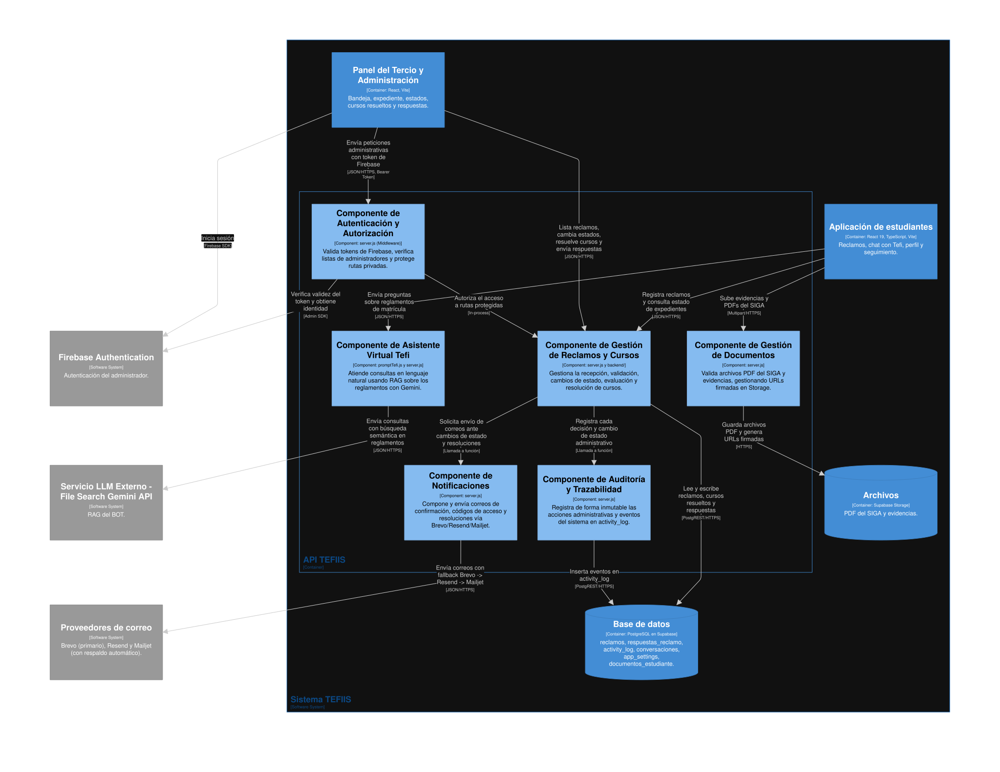

# Modelo C4 de TEFIIS

Sección 3 del informe de la Entrega 1 (SW708, equipo 2). Los tres niveles salen de un solo archivo, [workspace.dsl](workspace.dsl), escrito en Structurizr DSL. Cada figura incluye solo lo que existe en el código del commit revisado: los dos repositorios que forman el sistema (este, con la aplicación de estudiantes y la API, y `sistema-admin`, con el panel), los servicios externos a los que llama el código y, en el tercer nivel, los archivos de la rodaja.

## Leyenda

Vale para las tres figuras. Structurizr escribe los tipos en inglés dentro de cada caja (`[Person]`, `[Container]`); esta tabla dice qué significan. Para el detalle de responsabilidad de cada caja en una sola línea, consultar [leyenda.md](leyenda.md). Cada figura tiene además su leyenda generada (`img/*-key.png`).

| Forma y color         | Tipo                        | Qué representa                                                                                                |
| --------------------- | --------------------------- | ------------------------------------------------------------------------------------------------------------- |
| Silueta azul oscuro   | Persona (`Person`)          | Quien usa el sistema: el estudiante o el miembro del Tercio.                                                  |
| Rectángulo azul       | Sistema (`Software System`) | TEFIIS visto como una sola caja.                                                                              |
| Rectángulo gris       | Sistema externo             | Un servicio de terceros que el equipo no controla.                                                            |
| Rectángulo azul medio | Contenedor (`Container`)    | Algo que se despliega o se ejecuta por separado: una aplicación web o la API. Entre corchetes, su tecnología. |
| Cilindro azul medio   | Almacén de datos            | Un contenedor que guarda datos: la base PostgreSQL o el Storage de los PDF.                                   |
| Rectángulo celeste    | Componente (`Component`)    | Un archivo o una función de la API con una responsabilidad. Entre corchetes, la carpeta donde vive.           |
| Marco con borde azul  | Límite                      | Lo que está dentro pertenece al sistema o al contenedor que nombra el marco.                                  |
| Flecha                | Relación                    | Va de quien inicia a quien recibe. Dice qué pasa y, entre corchetes, el protocolo.                            |

## Figura 1. Contexto

**Qué muestra.** TEFIIS como una sola caja, las tres personas que interactúan con el sistema (Estudiante UNI-FIIS, Miembro del tercio estudiantil y Administrador del sistema) y los tres servicios externos de los que depende (Brevo, Servicio LLM con Gemini y Firebase Authentication).

**Observación del equipo.** El estudiante, el Tercio y el Administrador acceden a través de sus respectivos portales hacia el mismo sistema. Todo lo que sale de TEFIIS hacia la derecha es un servicio de terceros (envío de correos mediante Brevo, consulta semántica al modelo LLM con Gemini y validación de usuarios con Firebase Authentication).

Leyenda generada: [structurizr-Contexto-key.png](img/structurizr-Contexto-key.png)

## Figura 2. Contenedores

**Qué muestra.** Las dos aplicaciones web, la API y los dos almacenes de datos que forman TEFIIS, con la tecnología de cada uno y el protocolo de cada flecha. Las dos aplicaciones viven en repositorios distintos y hablan con una sola API.

**Observación del equipo.** Una sola API concentra las reglas: las dos aplicaciones web pueden validar la forma de los datos, pero lo que importa se vuelve a comprobar en el servidor, porque cualquiera con un token puede llamar a la API sin pasar por la interfaz. La base de datos y los archivos están en Supabase, pero la API los usa como dos contenedores distintos: PostgREST para las tablas y Storage para los PDF, que solo se entregan con URL firmadas.

Leyenda generada: [structurizr-Contenedores-key.png](img/structurizr-Contenedores-key.png)

## Figura 3. Componentes

**Qué muestra.** Los componentes de la API TEFIIS, el contenedor central que concentra las reglas de negocio. Muestra cómo se dividen las responsabilidades internas del backend en 6 componentes funcionales que agrupan clases, rutas y servicios.

**Observación del equipo.** El diagrama evidencia una arquitectura lógica de 6 componentes de negocio (Autenticación/Autorización, Gestión de Reclamos y Cursos, Asistente Tefi RAG, Notificaciones, Auditoría y Gestión de Documentos). Como hallazgo arquitectónico, varias de estas responsabilidades conviven hoy dentro del archivo `server.js` y módulos de `backend/`, por lo que el modelo C4 permite identificar con claridad los límites modulares a consolidar en futuras refactorizaciones.

Leyenda detallada: [leyenda.md](leyenda.md)

## Decisiones al modelar

- Las relaciones de contexto y de contenedores se declaran antes que las de componentes para preservar la claridad semántica de cada nivel en Structurizr.
- Se abre únicamente la API TEFIIS por ser el contenedor que concentra las reglas de negocio, manteniendo cerrados los demás contenedores.
- Cada componente agrupa una responsabilidad clara de negocio descrita en una sola línea, cumpliendo con la regla de mantener entre 4 y 8 componentes por contenedor.
- El panel del Tercio y Administración está dentro del límite de TEFIIS aunque vive en un repositorio independiente (`sistema-admin`), ya que opera directamente sobre la misma API central.
