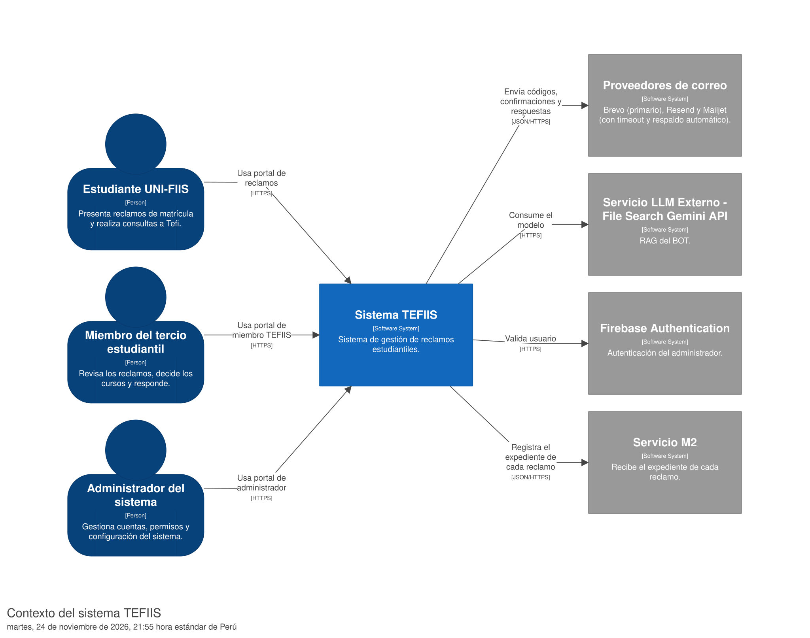
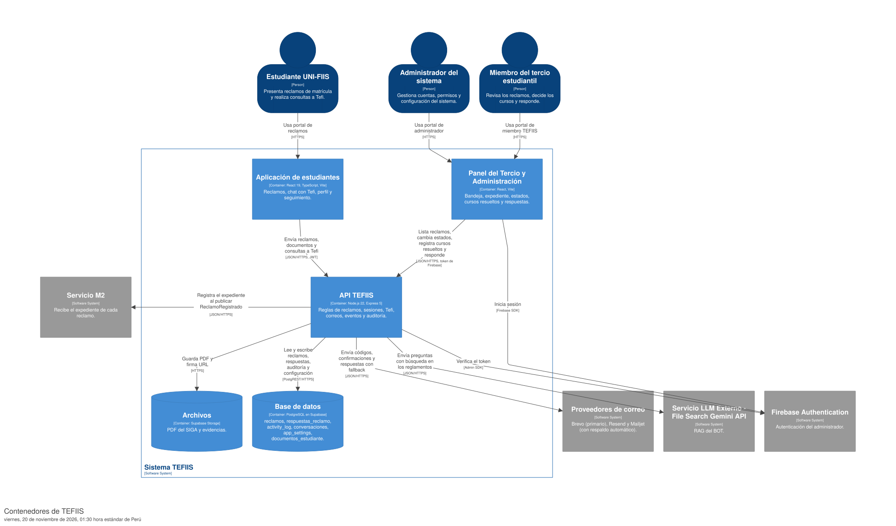

# Modelo C4 de TEFIIS

Sección 3 del informe de arquitectura. Los tres niveles se derivan del archivo [workspace.dsl](workspace.dsl), escrito en Structurizr DSL. Cada figura modela los dos clientes que forman el sistema (la aplicación de estudiantes en `sistema-reclamos/` y el panel en `sistema-admin/`, ambos dentro de este mismo repositorio), los servicios externos con los que se comunica y, en el tercer nivel, la partición modular real de la API TEFIIS en **7 workspaces de npm** conectados en `backend/server.js` (Lab09, `#50`/`#67`/`#68`), con sus puertos, adaptadores intercambiables, el flujo por eventos `ReclamoRegistrado` activo (`#27`/`#58`/`#46`) y el enviador de correo con timeout y circuit breaker (`opossum`, `#34`/`#58`/`#73`).

Para el detalle de responsabilidad de cada elemento en una sola línea, las fronteras verificadas con `dependency-cruiser` y el estado integrado en `develop`, consultar [leyenda.md](leyenda.md).

## Leyenda de Notación C4

| Forma y color | Tipo | Qué representa |
| :--- | :--- | :--- |
| **Silueta azul oscuro** | Persona (`Person`) | Quien usa el sistema: Estudiante UNI-FIIS, Miembro del tercio estudiantil o Administrador del sistema. |
| **Rectángulo azul** | Sistema (`Software System`) | TEFIIS visto como una sola caja central. |
| **Rectángulo gris** | Sistema externo | Servicios de terceros que el equipo consume pero no controla (Gemini, Proveedores de correo, Firebase, Servicio M2). |
| **Rectángulo azul medio** | Contenedor (`Container`) | Piezas que se ejecutan o despliegan por separado (frontends React o la API Express). Entre corchetes, su tecnología real. |
| **Cilindro azul medio** | Almacén de datos | Contenedores que persisten datos: la base PostgreSQL o el Storage de evidencias en Supabase. |
| **Rectángulo celeste** | Componente (`Component`) | Paquetes workspace (`@tefiis/*`) que agrupan responsabilidades y límites verificados dentro de la API TEFIIS. |
| **Marco con borde azul** | Límite de sistema | Delimita los contenedores que forman parte de TEFIIS. |
| **Flecha con etiqueta** | Relación | Describe la acción mediante un verbo y, entre corchetes, el protocolo o puerto (`HTTPS`, `JSON/HTTPS`, `In-process`, `Evento en proceso`). |

---

## Figura 1. Contexto

*Leyenda generada:* [Contexto-key.svg](img/Contexto-key.svg)

* **Qué muestra:** TEFIIS como una sola caja central, los tres actores que interactúan con él mediante portales web (Estudiante UNI-FIIS, Miembro del tercio estudiantil y Administrador del sistema) y los cuatro servicios externos de los que depende: Proveedores de correo (Brevo, Resend, Mailjet), Gemini API (RAG de Tefi), Firebase Authentication (seguridad del panel) y el Servicio M2 (recibe el expediente de cada reclamo).
* **Observación del equipo:** Brevo no es un punto único de falla porque `@tefiis/compartido` implementa respaldo automático en cascada (`Brevo -> Resend -> Mailjet`) con tiempo límite (`AbortSignal.timeout`, `#34`/`#58`) y circuit breaker por proveedor (`opossum`, `#73`) en `crearEnviadorCorreo`, conectado al arranque en `server.js`. Cuando un proveedor acumula fallas o timeouts dentro de la ventana deslizante (excluyendo errores `400`/`422` del destinatario), su circuito se abre y los siguientes envíos conmutan en memoria al respaldo sin esperar un nuevo timeout. Además, en el registro de reclamos, el envío de correo de confirmación y el expediente a M2 corren en segundo plano mediante el bus en proceso `ReclamoRegistrado` (`#27`/`#58`), por lo que una falla externa no bloquea ni revierte el `201 Created` al estudiante. Como limitación conocida, el bus en proceso no reintenta automáticamente ante fallas y, si los tres proveedores agotan su cuota a la vez en un envío síncrono (código de verificación o respuesta del Tercio), la petición falla. Gemini y Firebase siguen siendo dependencias externas sin proveedor alternativo.

---

## Figura 2. Contenedores

*Leyenda generada:* [Contenedores-key.svg](img/Contenedores-key.svg)

* **Pie de figura:** Diagrama de contenedores de TEFIIS. Las dos aplicaciones web viven en carpetas del mismo repositorio (`sistema-reclamos/` y `sistema-admin/`) y hablan con una sola API, que publica `ReclamoRegistrado` con el notificador de correo y el envío a M2 como consumidores activos en `server.js` (`#58`). *(Compatibilidad de despliegue `#46`: el frontend nuevo envía `"avisos": "api"` en `POST /api/reclamos` para delegar correo y M2 a la API, y solo recurre a `POST /api/reclamos/confirmar` y al `fetch` directo a M2 si recibe una respuesta sin `"avisos": "api"` de una API anterior).*
* **Qué muestra:** La arquitectura de ejecución de TEFIIS en 5 contenedores: dos aplicaciones web cliente en React (`Aplicación de estudiantes` en `sistema-reclamos/` y `Panel del Tercio y Administración` en `sistema-admin/`, ambas carpetas de este mismo repositorio), la `API TEFIIS` en Node.js 22 / Express 5, y dos almacenes de datos desacoplados en Supabase (`Base de datos PostgreSQL` y `Storage de Archivos`), junto con sus protocolos reales de red.
* **Observación del equipo:** Una sola API concentra todas las reglas de negocio, eventos y auditoría. El panel administrativo (`sistema-admin/`) y la aplicación de estudiantes (`sistema-reclamos/`) conviven en carpetas del mismo repositorio y hablan con la misma API backend. Supabase cumple dos roles arquitectónicos distintos que se modelan por separado: persistencia relacional transaccional (PostgreSQL vía PostgREST) y almacenamiento de evidencias PDF mediante URLs firmadas seguras (Storage). Al registrar un reclamo, la API publica `ReclamoRegistrado` en `busEnProceso` y los dos consumidores de `@tefiis/notificaciones` (`notificarReclamoRegistrado` y `enviarExpedienteAM2`, con timeout de 60 s para M2 en Render) despachan el correo de confirmación y el expediente sin demorar la respuesta al estudiante ([docs/api/eventos.md](../api/eventos.md)).

---

## Figura 3. Componentes

*Leyenda generada:* [Componentes-key.svg](img/Componentes-key.svg)

* **Qué muestra:** El interior del contenedor central (`API TEFIIS`), particionado en sus **7 paquetes workspace reales** conectados por `backend/server.js`: `@tefiis/acceso`, `@tefiis/reclamos`, `@tefiis/notificaciones`, `@tefiis/configuracion`, `@tefiis/documentos`, `@tefiis/tefi` y `@tefiis/compartido`, reflejando los puertos inyectados (`PublicadorEventos`, `PoliticaDeRecepcion`, `FuenteDeExpedientes`, `ClienteM2`, `RepositorioReclamos`, `RepositorioCursosResueltos`) y los límites verificados por `.dependency-cruiser.cjs`.
* **Observación del equipo:** Ningún módulo de negocio importa directamente a otro (`modulo-no-importa-otro-modulo`) y `@tefiis/compartido` no importa ningún módulo (`compartido-no-importa-modulos`). Toda colaboración entre módulos pasa por puertos que inyecta `server.js` al arrancar o por el bus en proceso `busEnProceso`. Dentro de `@tefiis/reclamos` y `@tefiis/notificaciones`, el dominio y la aplicación permanecen aislados de infraestructura y paquetes npm (`dominio-limpio`, `aplicacion-sin-infraestructura`, `dominio-sin-paquetes`), con adaptadores intercambiables en Supabase/HTTP y en memoria verificados sin credenciales en CI (`npm test && npm run arch:check`).

---

## Decisiones de Modelado

- Las relaciones de contexto y de contenedores se declaran antes que las de componentes en [workspace.dsl](workspace.dsl) para que Structurizr preserve la claridad semántica de cada nivel.
- Se abre únicamente la `API TEFIIS` por ser el contenedor que concentra las reglas de negocio, los módulos particionados y el bus de eventos, manteniendo cerrados los demás.
- Los **7 componentes** del Nivel 3 corresponden 1 a 1 con los 7 workspaces de npm del backend ([docs/particiones.md](../particiones.md)), cumpliendo la regla C4 de mantener entre 4 y 8 componentes por contenedor sin inventar cajas ni dibujar archivos sueltos.
- Se retiraron las etiquetas `(objetivo #27)` porque el bus en proceso, los dos consumidores en `@tefiis/notificaciones`, el enviador de correo con timeout y la transición `"avisos": "api"` del frontend ya están integrados y activos en `develop` (`#58`, `#46`, `#67`, `#68`).
