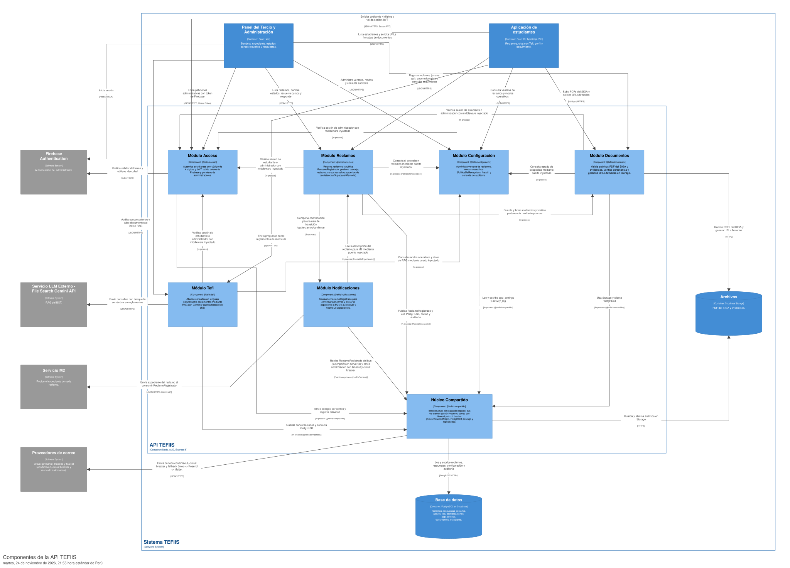

# Modelo C4 de TEFIIS

Sección 3 del informe de arquitectura. Los tres niveles se derivan del archivo [workspace.dsl](workspace.dsl), escrito en Structurizr DSL. Cada figura modela los dos clientes que forman el sistema (la aplicación de estudiantes en `sistema-reclamos/` y el panel en `sistema-admin/`, ambos dentro de este mismo repositorio), los servicios externos con los que se comunica y, en el tercer nivel, la arquitectura modular interna de la API TEFIIS con sus puertos, adaptadores intercambiables y el flujo por eventos `ReclamoRegistrado` implementado en `backend/` (#27, cuyas relaciones hacia `busEnProceso` y `Servicio M2` se rotulan como `objetivo #27` mientras se conectan en `server.js`).

Para el detalle de responsabilidad de cada elemento en una sola línea y la tabla de qué está ya conectado en `server.js` frente a lo pendiente de conectar, consultar [leyenda.md](leyenda.md).

## Leyenda de Notación C4

| Forma y color | Tipo | Qué representa |
| :--- | :--- | :--- |
| **Silueta azul oscuro** | Persona (`Person`) | Quien usa el sistema: Estudiante UNI-FIIS, Miembro del tercio estudiantil o Administrador del sistema. |
| **Rectángulo azul** | Sistema (`Software System`) | TEFIIS visto como una sola caja central. |
| **Rectángulo gris** | Sistema externo | Servicios de terceros que el equipo consume pero no controla (Gemini, Proveedores de correo, Firebase, Servicio M2). |
| **Rectángulo azul medio** | Contenedor (`Container`) | Piezas que se ejecutan o despliegan por separado (frontends React o la API Express). Entre corchetes, su tecnología real. |
| **Cilindro azul medio** | Almacén de datos | Contenedores que persisten datos: la base PostgreSQL o el Storage de evidencias en Supabase. |
| **Rectángulo celeste** | Componente (`Component`) | Módulos lógicos, puertos/adaptadores y consumidores de eventos que agrupan responsabilidades dentro de la API TEFIIS. |
| **Marco con borde azul** | Límite de sistema | Delimita los contenedores que forman parte de TEFIIS. |
| **Flecha con etiqueta** | Relación | Describe la acción mediante un verbo y, entre corchetes, el protocolo o puerto (`HTTPS`, `JSON/HTTPS`, `In-process`, `Evento en proceso`). |

---

## Figura 1. Contexto

*Leyenda generada:* [Contexto-key.svg](img/Contexto-key.svg)

* **Qué muestra:** TEFIIS como una sola caja central, los tres actores que interactúan con él mediante portales web (Estudiante UNI-FIIS, Miembro del tercio estudiantil y Administrador del sistema) y los cuatro servicios externos de los que depende: Proveedores de correo (Brevo, Resend, Mailjet), Gemini API (RAG de Tefi), Firebase Authentication (seguridad del panel) y el Servicio M2 (recibe el expediente de cada reclamo).
* **Observación del equipo:** Brevo no es un punto único de falla porque el backend implementa respaldo automático en cascada: `Brevo -> Resend -> Mailjet` (`server.js:311-333`). No obstante, el modelado reveló que en `server.js` las llamadas carecen de timeout (pudiendo demorar la respuesta si un proveedor se cuelga) y que, si los tres proveedores agotan su cuota a la vez, el envío falla síncronamente al no contar con una cola de reintentos en segundo plano *(riesgos mitigados en el adaptador `crearEnviadorCorreo` de #34 y en el flujo por eventos `ReclamoRegistrado` de #27, ambos pendientes de conectar en `server.js`)*. Por el contrario, Gemini y Firebase sí constituyen dependencias externas sin proveedor alternativo.

---

## Figura 2. Contenedores

*Leyenda generada:* [Contenedores-key.svg](img/Contenedores-key.svg)

* **Pie de figura:** Diagrama de contenedores de TEFIIS. Las dos aplicaciones web viven en carpetas del mismo repositorio (`sistema-reclamos/` y `sistema-admin/`) y hablan con una sola API, que publica `ReclamoRegistrado` con el notificador de correo y el envío a M2 como consumidores (`objetivo #27`). *(Nota de transición: el flujo por eventos ya está en `develop` en `backend/`, pero mientras no se conecte en `server.js` y se retiren las llamadas de `useReclamos.ts:898-946`, el servidor levantado sigue pasando por `POST /api/reclamos/confirmar` y el `fetch` del frontend a M2; en `docs/resiliencia.md` se especifica cuál de los dos caminos mide cada parte del experimento).*
* **Qué muestra:** La arquitectura de ejecución de TEFIIS en 5 contenedores: dos aplicaciones web cliente en React (`Aplicación de estudiantes` en `sistema-reclamos/` y `Panel del Tercio y Administración` en `sistema-admin/`, ambas carpetas de este mismo repositorio), la `API TEFIIS` en Node.js 22 / Express 5, y dos almacenes de datos desacoplados en Supabase (`Base de datos PostgreSQL` y `Storage de Archivos`), junto con sus protocolos reales de red.
* **Observación del equipo:** Una sola API concentra todas las reglas de negocio, eventos y auditoría. El panel administrativo (`sistema-admin/`) y la aplicación de estudiantes (`sistema-reclamos/`) conviven en carpetas del mismo repositorio y hablan con la misma API backend. Supabase cumple dos roles arquitectónicos distintos que se modelan por separado: persistencia relacional transaccional (PostgreSQL vía PostgREST) y almacenamiento de evidencias PDF mediante URLs firmadas seguras (Storage). Con el flujo por eventos de [docs/api/eventos.md](../api/eventos.md) (`objetivo #27`, implementado en `backend/` y pendiente de enganchar en `server.js`), al registrar un reclamo la API publica `ReclamoRegistrado` y sus dos consumidores (`notificarReclamoRegistrado` y `enviarExpedienteAM2`) despachan el correo de confirmación y envían el expediente al Servicio M2.

---

## Figura 3. Componentes

*Leyenda generada:* [Componentes-key.svg](img/Componentes-key.svg)

* **Qué muestra:** El interior del contenedor central (`API TEFIIS`), descompuesto en sus 8 componentes arquitectónicos: `Autenticación y Autorización`, `Gestión de Reclamos y Cursos`, `Adaptadores de Persistencia`, `Bus de Eventos y Consumidor M2`, `Notificaciones`, `Asistente Virtual Tefi (RAG)`, `Auditoría y Trazabilidad` y `Gestión de Documentos`, mostrando cómo el dominio se comunica por puertos con sus adaptadores intercambiables y cómo publica `ReclamoRegistrado` (`objetivo #27`).
* **Observación del equipo:** El diagrama refleja las dos capacidades desacopladas en `backend/` con arquitectura hexagonal: la resolución de cursos (`guardarCursosResueltos` sobre el puerto `RepositorioCursosResueltos`, con sus dos adaptadores `repositorioCursosSupabase` y `repositorioCursosMemoria`, ya conectada en `server.js:1207-1209`) y el registro de reclamos por eventos (`registrarReclamo` sobre `RepositorioReclamos` y `PublicadorEventos`, implementado por `busEnProceso` y `publicadorMemoria` en #27, pendiente de conectar en `server.js`). Las demás rutas administrativas de `server.js` aún invocan `sbRest` directamente.

---

## Decisiones de Modelado

- Las relaciones de contexto y de contenedores se declaran antes que las de componentes en [workspace.dsl](workspace.dsl) para que Structurizr preserve la claridad semántica de cada nivel.
- Se abre únicamente la `API TEFIIS` por ser el contenedor que concentra las reglas de negocio, los puertos/adaptadores y el bus de eventos, manteniendo cerrados los demás.
- Cada componente agrupa una responsabilidad arquitectónica clara descrita en una sola línea, cumpliendo con la regla de mantener entre 4 y 8 componentes por contenedor (8 componentes en total) y mostrando explícitamente los puertos y adaptadores intercambiables (Supabase/HTTP y Memoria).
- Las relaciones del flujo por eventos `ReclamoRegistrado` implementadas en `backend/` (#27) pero aún no enganchadas en `server.js` se rotulan con `(objetivo #27)` para distinguir qué corre hoy en el servidor levantado frente a lo que ya existe como módulos probados en `develop`.
