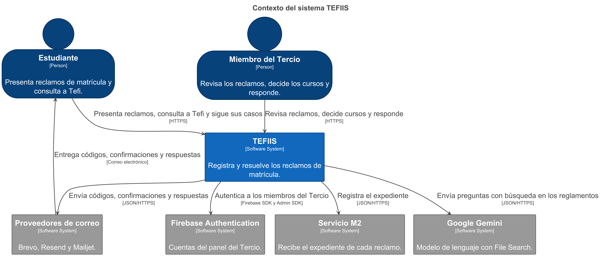
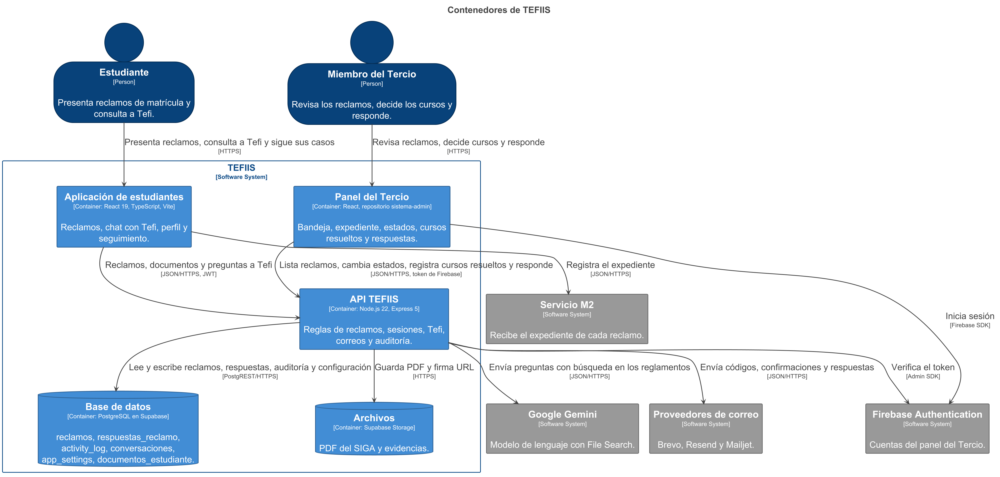
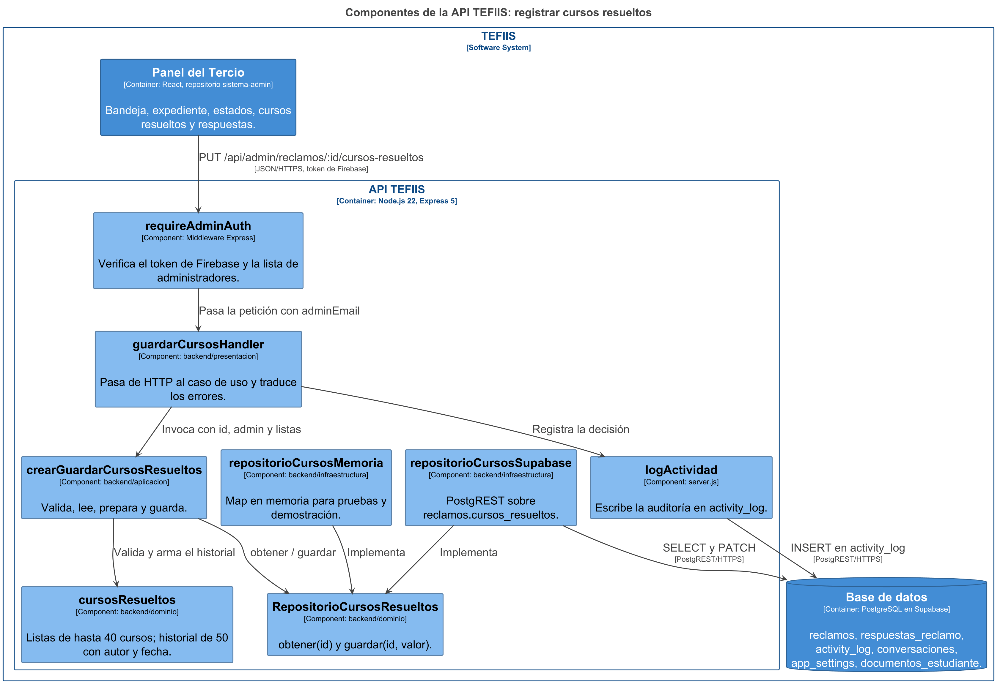

# Modelo C4 de TEFIIS

Sección 3 del informe de la Entrega 1 (SW708, equipo 2). Los tres niveles salen de un solo archivo, [workspace.dsl](workspace.dsl), escrito en Structurizr DSL. Cada figura incluye solo lo que existe en el código del commit revisado: los dos repositorios que forman el sistema (este, con la aplicación de estudiantes y la API, y `sistema-admin`, con el panel), los servicios externos a los que llama el código y, en el tercer nivel, los archivos de la rodaja.

## Leyenda

Vale para las tres figuras. Structurizr escribe los tipos en inglés dentro de cada caja (`[Person]`, `[Container]`); esta tabla dice qué significan. Cada figura tiene además su leyenda generada (`img/*-key.png`).

| Forma y color | Tipo | Qué representa |
|---|---|---|
| Silueta azul oscuro | Persona (`Person`) | Quien usa el sistema: el estudiante o el miembro del Tercio. |
| Rectángulo azul | Sistema (`Software System`) | TEFIIS visto como una sola caja. |
| Rectángulo gris | Sistema externo | Un servicio de terceros que el equipo no controla. |
| Rectángulo azul medio | Contenedor (`Container`) | Algo que se despliega o se ejecuta por separado: una aplicación web o la API. Entre corchetes, su tecnología. |
| Cilindro azul medio | Almacén de datos | Un contenedor que guarda datos: la base PostgreSQL o el Storage de los PDF. |
| Rectángulo celeste | Componente (`Component`) | Un archivo o una función de la API con una responsabilidad. Entre corchetes, la carpeta donde vive. |
| Marco con borde azul | Límite | Lo que está dentro pertenece al sistema o al contenedor que nombra el marco. |
| Flecha | Relación | Va de quien inicia a quien recibe. Dice qué pasa y, entre corchetes, el protocolo. |

## Figura 1. Contexto

**Qué muestra.** TEFIIS como una sola caja, las dos personas que lo usan y los cuatro servicios externos de los que depende.

**Observación del equipo.** El estudiante y el Tercio entran por puertas distintas al mismo sistema y nunca comparten pantalla. Todo lo que sale de TEFIIS es un servicio de terceros: cada flecha hacia abajo es una dependencia que puede fallar sin que el equipo pueda arreglarla, y de una de ellas nace el escenario E5. El correo le llega al estudiante a través de los proveedores; TEFIIS no tiene servidor de correo propio. El servicio M2 es el único externo que no se configura en la API: lo llama directamente la aplicación de estudiantes (figura 2).

Leyenda generada: [structurizr-Contexto-key.png](img/structurizr-Contexto-key.png)

## Figura 2. Contenedores

**Qué muestra.** Las dos aplicaciones web, la API y los dos almacenes de datos que forman TEFIIS, con la tecnología de cada uno y el protocolo de cada flecha. Las dos aplicaciones viven en repositorios distintos y hablan con una sola API.

**Observación del equipo.** Una sola API concentra las reglas: las dos aplicaciones web pueden validar la forma de los datos, pero lo que importa se vuelve a comprobar en el servidor, porque cualquiera con un token puede llamar a la API sin pasar por la interfaz. La base de datos y los archivos están en Supabase, pero la API los usa como dos contenedores distintos: PostgREST para las tablas y Storage para los PDF, que solo se entregan con URL firmadas. La aplicación de estudiantes llama directamente al servicio M2 sin pasar por la API; es la única integración que la API no controla y la revisaremos con el flujo por eventos.

Leyenda generada: [structurizr-Contenedores-key.png](img/structurizr-Contenedores-key.png)

## Figura 3. Componentes de la rodaja

**Qué muestra.** Los componentes de la API que intervienen en «registrar cursos resueltos». Cada caja es un archivo de `backend/` o una función de `server.js`; los dos adaptadores implementan el mismo puerto.

**Observación del equipo.** El caso de uso solo conoce el puerto; `server.js` decide qué adaptador inyectar y en producción usa el de Supabase. El adaptador en memoria no se usa en producción: existe para que la misma prueba corra sin base de datos y para demostrar que el puerto está bien puesto. `requireAdminAuth` y `logActividad` todavía viven dentro de `server.js`: son parte del sistema anterior y no tienen archivo propio.

Leyenda generada: [structurizr-Componentes-key.png](img/structurizr-Componentes-key.png)

## Decisiones al modelar

- Las relaciones de contexto y de contenedores se declaran antes que las de componentes. Si no, Structurizr deduce la flecha de un nivel a partir de una del nivel de abajo, y el diagrama de contenedores decía que la API solo hace «SELECT y PATCH» en la base y que el panel solo llama a una ruta.
- La flecha del correo al estudiante se muestra en el contexto y se excluye en contenedores, donde empujaba al estudiante al fondo del diagrama sin agregar información.
- El panel del Tercio está dentro del límite de TEFIIS aunque vive en otro repositorio: sin él no se puede resolver ningún reclamo, y usa la misma API que la aplicación de estudiantes.
