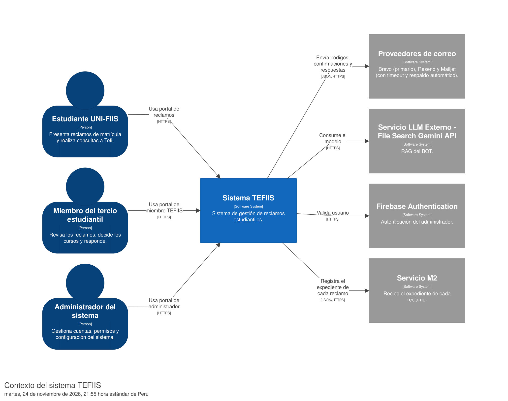
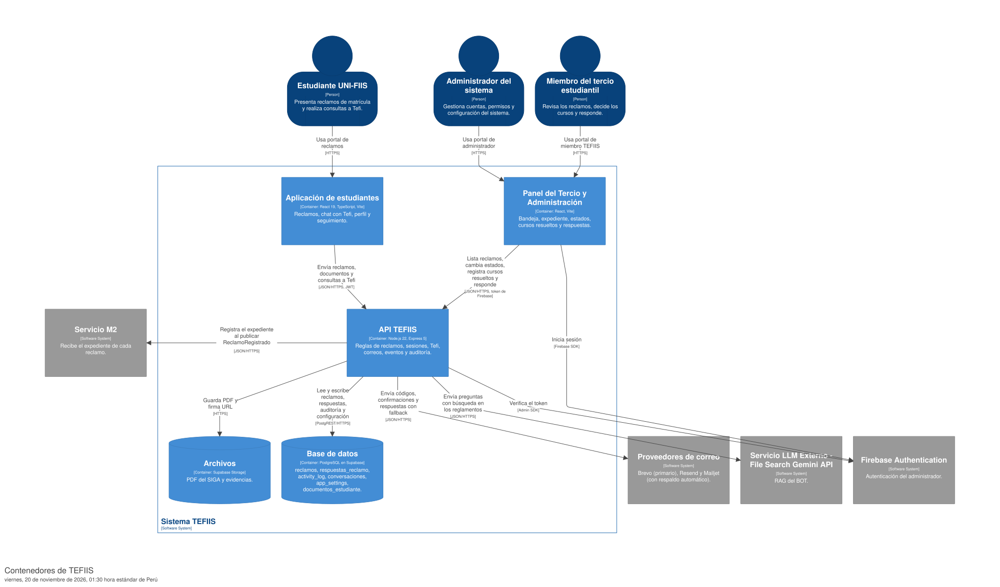
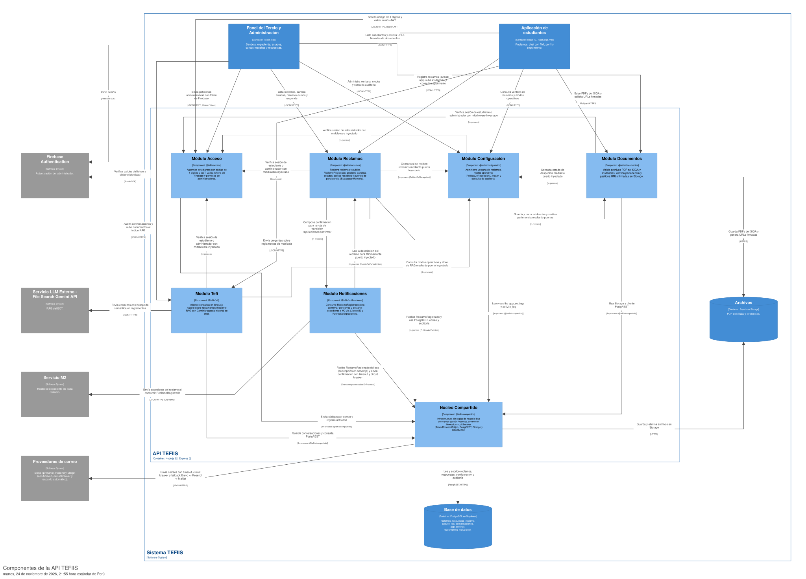

# Leyenda de Responsabilidades y Análisis – Modelo C4 (TEFIIS)

Responsabilidades y decisiones de alcance de los diagramas C4 de TEFIIS. El modelo está en [workspace.dsl](workspace.dsl).

---

## 1. Nivel 1: Diagrama de Contexto (Sistema TEFIIS)

*Leyenda generada:* [Contexto-key.svg](img/Contexto-key.svg)

### Qué muestra
TEFIIS como una sola caja negra de software central, los tres actores que interactúan con él a través de sus respectivos portales web (Estudiante UNI-FIIS, Miembro del tercio estudiantil y Administrador del sistema), y los cuatro servicios externos de los que depende: **Proveedores de correo** (con timeout, circuit breaker y respaldo automático entre Brevo, Resend y Mailjet), **Gemini API** para el asistente inteligente Tefi (RAG), **Firebase Authentication** para la autenticación del panel administrativo y el **Servicio M2**, que recibe el expediente de cada reclamo registrado.

### Qué se decidió dejar afuera a propósito
* **La entrega física del correo al estudiante:** Se omitió la flecha de retorno desde los proveedores de correo hacia el estudiante (y la infraestructura de buzones como Gmail o correo institucional). El sistema cumple su responsabilidad entregando la petición a la API del proveedor de correo; modelar el rebote al estudiante generaba un ciclo visual innecesario en la vista de contexto.
* **Infraestructura de red y hosting:** No se detallan servidores de despliegue, DNS ni proxies reversos (Cloudflare Workers, Railway, Render), manteniendo el diagrama en un nivel puramente funcional y de negocio.

### Observación del equipo
> El adaptador `crearEnviadorCorreo` prueba Brevo, Resend y Mailjet en ese orden. Cada proveedor tiene un timeout de 3 000 ms por defecto y su propio circuit breaker. Los errores 400 y 422 del destinatario quedan fuera del conteo del circuito.
>
> En el registro de reclamos, el flujo por eventos `ReclamoRegistrado` (`#27`/`#58`) desacopla el correo de confirmación y el envío del expediente a M2 mediante `busEnProceso`, de modo que un proveedor lento o M2 dormido en Render (con timeout de 60 s en `crearClienteM2Http`) no demoran ni abortan el `201 Created` al estudiante.
>
> **Limitaciones conocidas:** el bus en proceso no reintenta eventos fallidos ni persiste trabajos pendientes entre reinicios, y si los tres proveedores agotan su cuota a la vez en un envío síncrono (código de verificación o respuesta del Tercio), la operación devuelve error. Por su parte, **Google Gemini y Firebase Authentication siguen siendo puntos únicos de falla externos** sin proveedor alternativo.

### Tabla de Responsabilidades – Nivel 1
| Elemento | Tipo | Responsabilidad (una línea) |
| :--- | :--- | :--- |
| **Estudiante UNI-FIIS** | Persona | Ingresa al portal de estudiantes para registrar solicitudes de reclamo de matrícula y consultar reglamentos mediante Tefi. |
| **Miembro del tercio estudiantil** | Persona | Utiliza el panel de gestión para revisar expedientes de reclamos, proponer soluciones y emitir respuestas a los alumnos. |
| **Administrador del sistema** | Persona | Accede al panel administrativo para gestionar cuentas de usuario, permisos y parámetros operativos del sistema. |
| **Sistema TEFIIS** | Software System | Registra, gestiona, automatiza y resuelve integralmente el ciclo de vida de los reclamos de matrícula estudiantiles. |
| **Proveedores de correo** | Sistema externo | Despacha correos electrónicos transaccionales con códigos de verificación, confirmaciones y resoluciones con timeout, circuit breaker (`opossum`) y fallback automático (`Brevo -> Resend -> Mailjet`). |
| **Servicio LLM Externo (Gemini API)** | Sistema externo | Ejecuta la búsqueda semántica sobre los reglamentos universitarios indexados (RAG) para generar las respuestas del asistente Tefi. |
| **Firebase Authentication** | Sistema externo | Gestiona la autenticación, emisión y validación de tokens de identidad para el acceso seguro al panel administrativo. |
| **Servicio M2** | Sistema externo | Recibe el expediente de cada reclamo (ID, código, correo, nombre, motivo y descripción) al registrarse en el sistema. |

---

## 2. Nivel 2: Diagrama de Contenedores (Sistema TEFIIS)

*Leyenda generada:* [Contenedores-key.svg](img/Contenedores-key.svg)

### Qué muestra
La arquitectura de ejecución del sistema dividida en sus 5 contenedores desplegables o almacenes de datos: dos aplicaciones cliente en React que viven en carpetas del mismo repositorio (`Aplicación de estudiantes` en `sistema-reclamos/` y `Panel del Tercio y Administración` en `sistema-admin/`), una API backend central en `Node.js 22 / Express 5` que concentra las reglas de negocio y la publicación de eventos, y dos contenedores de almacenamiento en Supabase (`Base de datos PostgreSQL` y `Storage de Archivos`), detallando los protocolos reales de comunicación entre ellos (`HTTPS`, `JSON/HTTPS con JWT/Bearer` y `PostgREST/HTTPS`).

### Qué se decidió dejar afuera a propósito
* **Estructura interna de la base de datos:** No se detallan tablas individuales (`reclamos`, `respuestas_reclamo`, `activity_log`, `conversaciones`) ni esquemas relacionales, tratándose la base de datos como una sola unidad transaccional.
* **Acceso directo Cliente-Supabase:** Aunque Supabase permite consultar datos directamente desde el frontend mediante su SDK cliente, se dejó fuera deliberadamente porque la arquitectura de TEFIIS obliga a que toda petición pase por la API Express para garantizar auditoría, validaciones y reglas de negocio.
* **Herramientas de construcción:** Se omitieron herramientas de compilación y empaquetado (Vite, TypeScript compiler, ESLint, dependency-cruiser).

### Observación del equipo
> **Doble rol de Supabase, monorrepo con dos carpetas y flujo integrado hacia correo y M2:**
> 1. **Supabase en dos contenedores:** Opera como una base relacional transaccional (PostgreSQL vía PostgREST) y como un almacén de objetos para evidencias y PDFs oficiales (Storage mediante URLs firmadas temporales).
> 2. **Dos aplicaciones web en el mismo repositorio ([ADR-0005](../adr/0005-un-repositorio-con-dos-carpetas.md)):** El panel del Tercio (`sistema-admin/`) y el portal estudiantil (`sistema-reclamos/`) viven en carpetas del mismo repositorio y hablan con una única API.
> 3. **Ruta activa de correo y M2 (`#58` y `#46`):** La `API TEFIIS` ya conecta `busEnProceso` y los consumidores de `@tefiis/notificaciones` en `backend/server.js`. Cuando la aplicación de estudiantes envía `"avisos": "api"` en `POST /api/reclamos` (`useReclamos.ts`), la API guarda el reclamo, publica `ReclamoRegistrado` y despacha tanto el correo de confirmación (`api -> correo`) como el expediente al `Servicio M2` (`api -> m2`, usando `M2_URL` en producción o `crearClienteM2Memoria` en desarrollo/Compose si la variable no está definida). Para compatibilidad durante despliegues desfasados entre Cloudflare y Railway, si el frontend no recibe `"avisos": "api"` en la respuesta, conserva temporalmente el respaldo por `POST /api/reclamos/confirmar` y `fetch` directo a M2.

### Tabla de Responsabilidades – Nivel 2
| Contenedor | Tecnología | Responsabilidad (una línea) |
| :--- | :--- | :--- |
| **Aplicación de estudiantes** | React 19, TypeScript, Vite (`sistema-reclamos/`) | Proporciona la interfaz web para que el estudiante registre reclamos, adjunte evidencias, converse con Tefi y consulte el estado de sus expedientes. |
| **Panel del Tercio y Administración** | React, Vite (`sistema-admin/`) | Brinda la interfaz de gestión para que miembros del Tercio y administradores evalúen expedientes, asignen estados y resuelvan cursos. |
| **API TEFIIS** | Node.js 22, Express 5 | Centraliza las reglas de negocio en 7 workspaces conectados en `server.js`, publica `ReclamoRegistrado`, integra IA y orquesta los servicios externos. |
| **Base de datos** | PostgreSQL en Supabase | Almacena y asegura de manera persistente las tablas de reclamos, respuestas, registros de auditoría, sesiones y configuraciones del sistema. |
| **Archivos** | Supabase Storage | Almacena los documentos PDF oficiales del SIGA y evidencias adjuntas por los estudiantes, sirviéndolos mediante URLs firmadas y seguras. |

---

## 3. Nivel 3: Diagrama de Componentes (API TEFIIS)

*Leyenda generada:* [Componentes-key.svg](img/Componentes-key.svg)

### Qué muestra
El contenedor central (`API TEFIIS`) abierto en sus **7 paquetes workspace reales** ([docs/particiones.md](../particiones.md)), conectados únicamente desde la raíz de composición `backend/server.js`: `@tefiis/acceso`, `@tefiis/reclamos`, `@tefiis/notificaciones`, `@tefiis/configuracion`, `@tefiis/documentos`, `@tefiis/tefi` y `@tefiis/compartido`. El diagrama refleja cómo ningún módulo importa a otro y cómo colaboran mediante puertos inyectados por `server.js` (`PublicadorEventos`, `PoliticaDeRecepcion`, `FuenteDeExpedientes`) o el bus en proceso en `@tefiis/compartido`.

### Qué se decidió dejar afuera a propósito
* **Raíz de composición `server.js` como caja separada:** `server.js` no contiene reglas de negocio; solo instancia los 7 workspaces, inyecta los puertos entre ellos y monta sus rutas Express, por lo que no se dibuja como un octavo componente de negocio.
* **Subcapas internas y funciones utilitarias:** No se dibuja una caja por cada archivo o función auxiliar (`sanearCursos`, `emailTemplate`, `subidas.js`), manteniendo 7 componentes de negocio/infraestructura acordes con la regla C4 (4 a 8 componentes por contenedor).
* **Configuraciones de transporte:** Se omiten middlewares genéricos de transporte (`express.json`, CORS, `express-rate-limit`).

### Contraste con el código integrado en `develop`

| Capacidad / Relación en el diagrama | Estado en `develop` | Dónde vive en el código |
| :--- | :--- | :--- |
| **Partición en 7 workspaces y raíz de composición** (`server.js`) | **Integrado y verificado por `arch:check` (`#50`/`#67`/`#68`)** | `backend/server.js`, `backend/modulos/{acceso,reclamos,notificaciones,configuracion,documentos,tefi}/` y `backend/compartido/`, verificados por `.dependency-cruiser.cjs`. |
| **Rodaja de cursos resueltos y registro de reclamos** (`@tefiis/reclamos`) | **Integrado y conectado en `server.js`** | `backend/modulos/reclamos/` (`dominio/`, `aplicacion/`, `infraestructura/` con adaptadores Supabase y Memoria para `RepositorioReclamos` y `RepositorioCursosResueltos`, y `presentacion/`). |
| **Flujo por eventos `ReclamoRegistrado` y consumidores de correo y M2** (`@tefiis/reclamos -> @tefiis/compartido`, `@tefiis/notificaciones -> @tefiis/compartido`, `@tefiis/notificaciones -> m2`) | **Integrado y activo en `server.js` (`#27`/`#58`/`#46`)** | `backend/compartido/eventos/busEnProceso.js`, `backend/modulos/notificaciones/` (`notificarReclamoRegistrado.js`, `enviarExpedienteAM2.js`, `clienteM2.js` con timeout de 60 s en producción o memoria sin `M2_URL`), conectado al arranque en `server.js` y consumido desde `useReclamos.ts` con `"avisos": "api"`. |
| **Adaptador de correo con Timeout (`AbortSignal.timeout`), Circuit Breaker (`opossum`) y URLs configurables** (`@tefiis/compartido -> correo`) | **Integrado y activo en `server.js` (`#34`/`#58`/`#73`)** | `backend/compartido/correo/enviadorCorreo.js` (timeout 3 000 ms por defecto con `EMAIL_TIMEOUT_MS` y circuit breaker `opossum` por proveedor con `EMAIL_CB_*`), conectado al arranque en `server.js` y validado en [docs/resiliencia.md](../resiliencia.md). |

### Tabla de Responsabilidades – Nivel 3
| Componente | Paquete / Ubicación | Responsabilidad (una línea) |
| :--- | :--- | :--- |
| **Módulo Acceso** | `@tefiis/acceso` (`backend/modulos/acceso/`) | Autentica estudiantes con código de 4 dígitos y JWT, valida tokens de Firebase y protege rutas con `requireStudentAuth` y `requireAdminAuth` (2 rutas). |
| **Módulo Reclamos** | `@tefiis/reclamos` (`backend/modulos/reclamos/`) | Ejecuta las reglas de dominio de reclamos y cursos resueltos con puertos intercambiables (`RepositorioReclamos`, `RepositorioCursosResueltos`, `PublicadorEventos`, `PoliticaDeRecepcion`), expone `FuenteDeExpedientes` y publica `ReclamoRegistrado` (12 rutas). |
| **Módulo Notificaciones** | `@tefiis/notificaciones` (`backend/modulos/notificaciones/`) | Implementa los dos consumidores de `ReclamoRegistrado` (confirmación por correo y envío del expediente a M2 vía `ClienteM2` y `FuenteDeExpedientes`), sin rutas HTTP propias. |
| **Módulo Configuración** | `@tefiis/configuracion` (`backend/modulos/configuracion/`) | Administra la ventana de reclamos, los modos operativos (almuerzo, mantenimiento, Tefi durmiendo, despedida), `/health` y la consulta de auditoría (`app_settings`, `activity_log`, 14 rutas). |
| **Módulo Documentos** | `@tefiis/documentos` (`backend/modulos/documentos/`) | Gestiona los PDFs académicos del SIGA y evidencias, valida pertenencia (`esEvidenciaPropia`, `esDocumentoPropio`) y firma URLs temporales (8 rutas). |
| **Módulo Tefi** | `@tefiis/tefi` (`backend/modulos/tefi/`) | Procesa consultas estudiantiles sobre reglamentos con RAG sobre Gemini (`promptTefi.js`) y gestiona el historial y auditoría de conversaciones (5 rutas). |
| **Núcleo Compartido** | `@tefiis/compartido` (`backend/compartido/`) | Provee infraestructura técnica sin reglas de negocio: bus de eventos (`busEnProceso`), correo con timeout, circuit breaker (`opossum`) y fallback (`crearEnviadorCorreo` + `plantillaCorreo`), cliente PostgREST (`sbRest`/`sbRestTodo`), Storage (`almacenamiento.js`) y registro de auditoría (`logActividad`). |

---

## 4. Observaciones del Equipo Revisor: Grupo 3

Tras cotejar el archivo [workspace.dsl](workspace.dsl) contra el código fuente del repositorio (`sistema-reclamos` y `sistema-admin`), el **Grupo 3** anota las siguientes observaciones:

1. **Componentes modelados como clases o archivos individuales (Nivel 3):**
   * En la versión inicial de la API TEFIIS se dibujaron funciones, interfaces y archivos de una sola operación (`guardarCursosHandler`, `cursosResueltos`, `RepositorioCursosResueltos`, `repositorioCursosSupabase`, etc.) en lugar de componentes arquitectónicos que agrupen responsabilidades de negocio. Se debe consolidar en componentes de negocio de nivel contenedor (entre 4 y 8 componentes).

2. **Flechas sin verbo o sin protocolo:**
   * **Sin verbo:** La relación `spa -> api` iniciaba con sustantivos (`"Reclamos, documentos y preguntas a Tefi"`), faltando un verbo de acción al inicio.
   * **Sin protocolo:** Las flechas internas entre componentes (`auth -> reclamos`, `reclamos -> notificaciones`, `reclamos -> auditoria`) no tenían protocolo de comunicación declarado (aparecían sin corchetes en el diagrama).

3. **Caja con ruta de repositorio en lugar de tecnología:**
   * El contenedor `panel` tenía declarado `"React, repositorio sistema-admin"`, utilizando la ubicación del repositorio en vez de su tecnología de ejecución pura (`"React, Vite"`).

4. **Discrepancias entre el repositorio y el diagrama:**
   * **Servicio M2 (observación corregida por el equipo):** El Grupo 3 anotó que el `Servicio M2` del modelo no tenía ninguna llamada en el código, y el equipo lo retiró. Al comprobarlo de nuevo, la aplicación de estudiantes sí lo llama: `useReclamos.ts` hace un `POST` a `https://tefiis-m2.onrender.com/api/v1/m2/expedientes` al enviar cada reclamo. Por eso se restituyó al modelo, en el contexto y en los contenedores.
   * **Proveedores de correo y protocolo:** El código cuenta con una cadena de fallback (`Brevo -> Resend -> Mailjet`) por llamadas HTTPS seguras; el DSL original reducía esto a un solo proveedor con protocolo `HTTP` inexacto. Se debe modelar como `Proveedores de correo` con protocolo `JSON/HTTPS`.

### Respuesta del equipo y actualizaciones posteriores (Entrega 1, Lab09, Lab10 y Lab11)

* **Atención a la observación 2 del docente sobre la Entrega 1 (#14 / #37):** Se actualizaron los diagramas para mostrar los puertos y adaptadores intercambiables (`Supabase/HTTP` y `Memoria`) y se corrigió el pie de la Figura 3.2 para reflejar que las dos aplicaciones web viven en carpetas del mismo repositorio (`sistema-reclamos/` y `sistema-admin/`, ADR-0005).
* **Validación contra la partición modular y el flujo de eventos integrado (#53):** Tras integrarse la conexión del bus `ReclamoRegistrado` y el correo con timeout en `server.js` (`#58`), la transición `"avisos": "api"` en el frontend (`#46`) y la partición real del backend en 7 workspaces (`#50`/`#67`/`#68`), se actualizó [workspace.dsl](workspace.dsl) y sus vistas para reflejar 1 a 1 los **7 paquetes reales** (`@tefiis/acceso`, `@tefiis/reclamos`, `@tefiis/notificaciones`, `@tefiis/configuracion`, `@tefiis/documentos`, `@tefiis/tefi` y `@tefiis/compartido`) y se retiraron las marcas `(objetivo #27)`.
