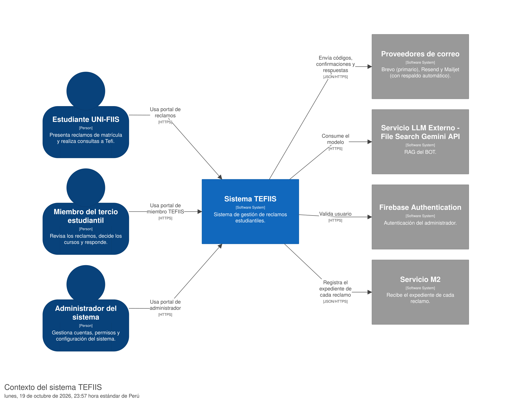
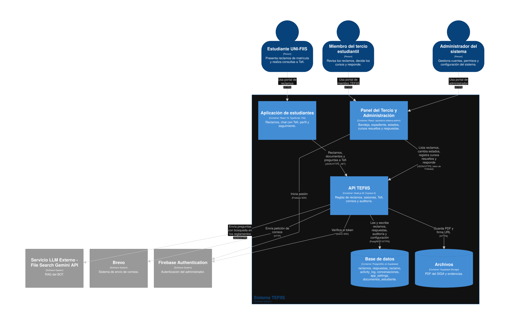
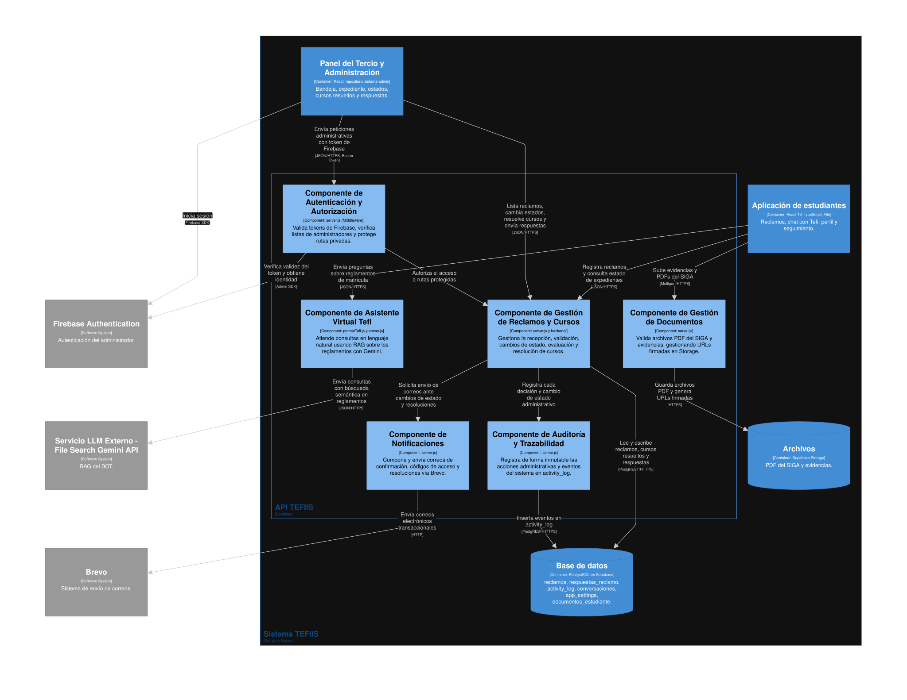

# Leyenda de Responsabilidades y Análisis – Modelo C4 (TEFIIS)

Este documento detalla la responsabilidad de cada componente y elemento modelado en los diagramas C4 del sistema TEFIIS en [workspace.dsl](workspace.dsl), junto con las decisiones de alcance, las observaciones arquitectónicas y las revisiones de cada nivel.

---

## 1. Nivel 1: Diagrama de Contexto (Sistema TEFIIS)

*Leyenda generada:* [Contexto-key.svg](img/Contexto-key.svg)

### Qué muestra
TEFIIS como una sola caja negra de software central, los tres actores que interactúan con él a través de sus respectivos portales web (Estudiante UNI-FIIS, Miembro del tercio estudiantil y Administrador del sistema), y los cuatro servicios externos de los que depende: **Proveedores de correo** (con respaldo automático entre Brevo, Resend y Mailjet), **Gemini API** para el asistente inteligente Tefi (RAG), **Firebase Authentication** para la autenticación del panel administrativo y el **Servicio M2**, al que la aplicación de estudiantes envía el expediente de cada reclamo.

### Qué se decidió dejar afuera a propósito
* **La entrega física del correo al estudiante:** Se omitió la flecha de retorno desde los proveedores de correo hacia el estudiante (y la infraestructura de buzones como Gmail o correo institucional). El sistema cumple su responsabilidad entregando la petición a la API del proveedor de correo; modelar el rebote al estudiante generaba un ciclo visual innecesario en la vista de contexto.
* **Infraestructura de red y hosting:** No se detallan servidores de despliegue, DNS ni proxies reversos (Vercel, Render), manteniendo el diagrama en un nivel puramente funcional y de negocio.

### Observación del equipo
> **Estrategia de respaldo en cascada y análisis de resiliencia en correos:** Al modelar las dependencias externas, el equipo constató que Brevo **no constituye un punto único de falla ni carece de failover**: la función `sendEmail` (`backend/server.js:311-333`) implementa un mecanismo de respaldo automático en cascada que intenta el envío por `Brevo`, y si este falla (por cuotas agotadas o errores HTTP), conmuta automáticamente a `Resend`, y finalmente a `Mailjet`. 
>
> Sin embargo, el ejercicio de modelado permitió identificar dos riesgos arquitectónicos importantes en esta implementación:
> 1. **Ausencia de timeout por proveedor:** Las funciones de envío (`sendViaBrevo`, `sendViaResend`, `sendViaMailjet`) ejecutan `fetch` sin un `AbortController` ni tiempo límite de espera. Si Brevo experimenta alta latencia o una conexión colgada, la petición del estudiante permanece bloqueada antes de pasar al siguiente proveedor, pudiendo provocar un timeout en la interfaz web.
> 2. **Falla simultánea de la cascada y bloqueo síncrono:** Si los tres proveedores fallan a la vez (por agotamiento acumulado de sus cuotas gratuitas diarias o caída general), `sendEmail` lanza una excepción que aborta el registro del reclamo o la emisión del código de acceso, al no disponer de una cola de mensajería asíncrona en segundo plano que reintente en diferido.
>
> Por el contrario, **Google Gemini y Firebase Authentication sí representan puntos únicos de falla reales**, ya que el sistema no dispone de ningún servicio alternativo en caso de que fallen o queden inaccesibles.

### Tabla de Responsabilidades – Nivel 1
| Elemento | Tipo | Responsabilidad (una línea) |
| :--- | :--- | :--- |
| **Estudiante UNI-FIIS** | Persona | Ingresa al portal de estudiantes para registrar solicitudes de reclamo de matrícula y consultar reglamentos mediante Tefi. |
| **Miembro del tercio estudiantil** | Persona | Utiliza el panel de gestión para revisar expedientes de reclamos, proponer soluciones y emitir respuestas a los alumnos. |
| **Administrador del sistema** | Persona | Accede al panel administrativo para gestionar cuentas de usuario, permisos y parámetros operativos del sistema. |
| **Sistema TEFIIS** | Software System | Registra, gestiona, automatiza y resuelve integralmente el ciclo de vida de los reclamos de matrícula estudiantiles. |
| **Proveedores de correo** | Sistema externo | Despacha correos electrónicos transaccionales con códigos de verificación y resoluciones con fallback automático (Brevo $\rightarrow$ Resend $\rightarrow$ Mailjet). |
| **Servicio LLM Externo (Gemini API)** | Sistema externo | Ejecuta la búsqueda semántica sobre los reglamentos universitarios indexados (RAG) para generar las respuestas del asistente Tefi. |
| **Firebase Authentication** | Sistema externo | Gestiona la autenticación, emisión y validación de tokens de identidad para el acceso seguro al panel administrativo. |
| **Servicio M2** | Sistema externo | Recibe el expediente de cada reclamo (ID, código, correo, nombre, motivo y descripción) que la aplicación de estudiantes le envía al registrarlo. |

---

## 2. Nivel 2: Diagrama de Contenedores (Sistema TEFIIS)

*Leyenda generada:* [Contenedores-key.svg](img/Contenedores-key.svg)

### Qué muestra
La arquitectura de ejecución del sistema dividida en sus 5 contenedores desplegables o almacenes de datos: dos aplicaciones cliente en React (`Aplicación de estudiantes` y `Panel del Tercio y Administración`), una API backend central en `Node.js 22 / Express 5` que concentra las reglas de negocio, y dos contenedores de almacenamiento en Supabase (`Base de datos PostgreSQL` y `Storage de Archivos`), detallando los protocolos reales de comunicación entre ellos (`HTTPS`, `JSON/HTTPS con JWT/Bearer` y `PostgREST/HTTPS`).

### Qué se decidió dejar afuera a propósito
* **Estructura interna de la base de datos:** No se detallan tablas individuales (`reclamos`, `respuestas_reclamo`, `activity_log`, `conversaciones`) ni esquemas relacionales, tratándose la base de datos como una sola unidad transaccional.
* **Acceso directo Cliente-Supabase:** Aunque Supabase permite consultar datos directamente desde el frontend mediante su SDK cliente, se dejó fuera deliberadamente porque la arquitectura de TEFIIS obliga a que toda petición pase por la API Express para garantizar auditoría, validaciones y reglas de negocio.
* **Herramientas de construcción:** Se omitieron herramientas de compilación y empaquetado (Vite, TypeScript compiler, ESLint).

### Observación del equipo
> **Doble rol de Supabase y acoplamiento frontend-backend:** El equipo notó dos aspectos arquitectónicos esenciales: primero, que Supabase no podía modelarse como una sola caja genérica, ya que opera en dos contenedores arquitectónicamente distintos: una base relacional transaccional (PostgreSQL vía PostgREST) y un almacén de objetos no estructurados para evidencias y PDFs oficiales (Storage mediante URLs firmadas temporales). Segundo, que el panel del Tercio (`sistema-admin/`) y el portal estudiantil (`sistema-reclamos/`) se mantienen en carpetas del mismo repositorio y dependen de forma síncrona de una única API. Si la API se cae o entra en mantenimiento, se paralizan simultáneamente el canal estudiantil y la gestión del Tercio. Además, la aplicación de estudiantes llama directamente al Servicio M2 sin pasar por la API: es la única integración que la API no controla. Esa llamada no bloquea el reclamo, pero tampoco se reintenta ni deja registro en la base: si falla, solo se avisa en la consola del navegador.

### Tabla de Responsabilidades – Nivel 2
| Contenedor | Tecnología | Responsabilidad (una línea) |
| :--- | :--- | :--- |
| **Aplicación de estudiantes** | React 19, TypeScript, Vite | Proporciona la interfaz web para que el estudiante registre reclamos, adjunte evidencias, converse con Tefi y consulte el estado de sus expedientes. |
| **Panel del Tercio y Administración** | React, Vite (`sistema-admin`) | Brinda la interfaz de gestión para que miembros del Tercio y administradores evalúen expedientes, asignen estados y resuelvan cursos. |
| **API TEFIIS** | Node.js 22, Express 5 | Centraliza las reglas de negocio, endpoints REST, validaciones de seguridad, integración con IA y orquestación de servicios externos. |
| **Base de datos** | PostgreSQL en Supabase | Almacena y asegura de manera persistente las tablas de reclamos, respuestas, registros de auditoría, sesiones y configuraciones del sistema. |
| **Archivos** | Supabase Storage | Almacena los documentos PDF oficiales del SIGA y evidencias adjuntas por los estudiantes, sirviéndolos mediante URLs firmadas y seguras. |

---

## 3. Nivel 3: Diagrama de Componentes (API TEFIIS)

*Leyenda generada:* [Componentes-key.svg](img/Componentes-key.svg)

### Qué muestra
El contenedor central (`API TEFIIS`) abierto en sus 6 componentes lógicos de negocio: `Autenticación y Autorización`, `Gestión de Reclamos y Cursos`, `Asistente Virtual Tefi (RAG)`, `Notificaciones`, `Auditoría y Trazabilidad` y `Gestión de Documentos`, detallando sus dependencias internas y conexiones hacia los almacenes de datos y servicios externos.

### Qué se decidió dejar afuera a propósito
* **Clases, middlewares y funciones sueltas:** Se descartó dibujar archivos individuales (como `guardarCursosHandler.js`, `cursosResueltos.js` o la función `requireAdminAuth`). Dibujarlos individualmente violaba la regla C4 de no hacer diagramas de clases UML.
* **Adaptadores de pruebas/mocks:** Se omitió el adaptador de persistencia en memoria (`repositorioCursosMemoria`), mostrando exclusivamente la infraestructura que atiende el tráfico real de producción.
* **Configuraciones utilitarias:** Se dejaron fuera los parsers de body JSON, cabeceras CORS y librerías utilitarias sin lógica de dominio.

### Observación del equipo
> **Deuda técnica de modularidad (Monolito en `server.js` vs. Arquitectura Lógica):** Al intentar abrir la API, el equipo descubrió que, mientras conceptualmente existen 6 componentes con responsabilidades claramente delimitadas, en el repositorio físico la mayor parte del código (rutas de reclamos, llamadas a proveedores de correo, autenticación de Firebase, consultas SQL y logs) sigue residiendo dentro de un único archivo monolítico (`server.js` de más de 100 KB), con solo una pequeña rodaja desacoplada en la carpeta `backend/`. El diagrama de componentes permitió visualizar las fronteras modulares que hoy existen en el diseño, sirviendo como mapa directo para la refactorización física del backend en el siguiente sprint.

### Tabla de Responsabilidades – Nivel 3
| Componente | Ubicación / Tipo | Responsabilidad (una línea) |
| :--- | :--- | :--- |
| **Componente de Autenticación y Autorización** | `server.js` (Middleware Express) | Valida los tokens de Firebase, verifica listas de administradores autorizados y protege las rutas privadas de la API. |
| **Componente de Gestión de Reclamos y Cursos** | `server.js` y `backend/` | Orquesta el ciclo de vida del reclamo: recepción de solicitudes, cambios de estado, evaluación académica y resolución de cursos. |
| **Componente de Asistente Virtual Tefi** | `promptTefi.js` y `server.js` | Procesa las consultas en lenguaje natural del estudiante consultando los reglamentos mediante búsqueda semántica (RAG) en Gemini. |
| **Componente de Notificaciones** | `server.js` | Compone y despacha correos automáticos implementando respaldo automático en cascada (Brevo $\rightarrow$ Resend $\rightarrow$ Mailjet). |
| **Componente de Auditoría y Trazabilidad** | `logActividad` en `server.js` | Registra de forma inmutable en la base de datos cada acción administrativa y cambio de estado sobre los reclamos. |
| **Componente de Gestión de Documentos** | `server.js` | Valida los archivos PDF del SIGA y evidencias adjuntas, gestionando su almacenamiento y URLs firmadas en Supabase Storage. |

---

## 4. Observaciones del Equipo Revisor: Grupo 3

Tras cotejar el archivo [workspace.dsl](workspace.dsl) contra el código fuente del repositorio (`sistema-reclamos` y `sistema-admin`), el **Grupo 3** anota las siguientes observaciones:

1. **Componentes modelados como clases o archivos individuales (Nivel 3):**
   * En la versión inicial de la API TEFIIS se dibujaron funciones, interfaces y archivos de una sola operación (`guardarCursosHandler`, `cursosResueltos`, `RepositorioCursosResueltos`, `repositorioCursosSupabase`, etc.) en lugar de componentes arquitectónicos que agrupen responsabilidades de negocio. Se debe consolidar en componentes de negocio de nivel contenedor (entre 4 y 8 componentes).

2. **Flechas sin verbo o sin protocolo:**
   * **Sin verbo:** La relación `spa -> api` iniciaba con sustantivos (`"Reclamos, documentos y preguntas a Tefi"`), faltando un verbo de acción al inicio.
   * **Sin protocolo:** Las flechas internas entre componentes (`auth -> reclamos`, `reclamos -> notificaciones`, `reclamos -> auditoria`) no tenían protocolo de comunicación declarado (aparecían sin corchetes en el diagrama).

3. **Caja con ruta de repositorio en lugar de tecnología:**
   * El contenedor `panel` tenía declarado `"React, repositorio sistema-admin"`, utilizando la ubicación del repositorio en vez de su tecnología de ejecución pura (`"React, Vite"`).

4. **Discrepancias entre el repositorio y el diagrama:**
   * **Servicio M2 (observación corregida por el equipo):** El Grupo 3 anotó que el `Servicio M2` del modelo no tenía ninguna llamada en el código, y el equipo lo retiró. Al comprobarlo de nuevo, la aplicación de estudiantes sí lo llama: `useReclamos.ts` hace un `POST` a `https://tefiis-m2.onrender.com/api/v1/m2/expedientes` al enviar cada reclamo. Por eso se restituyó al modelo, en el contexto y en los contenedores.
   * **Proveedores de correo y protocolo:** El código cuenta con una cadena de fallback (`Brevo -> Resend -> Mailjet`) por llamadas HTTPS seguras; el DSL original reducía esto a un solo proveedor con protocolo `HTTP` inexacto. Se debe modelar como `Proveedores de correo` con protocolo `JSON/HTTPS`.
