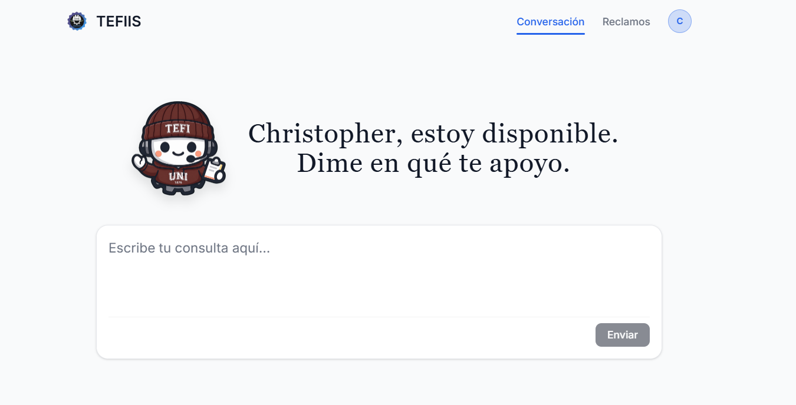
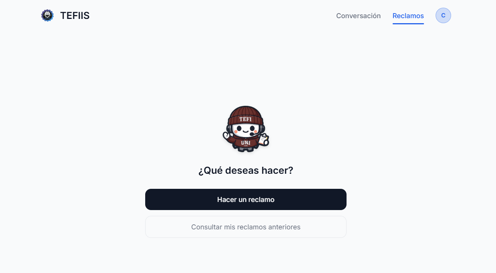
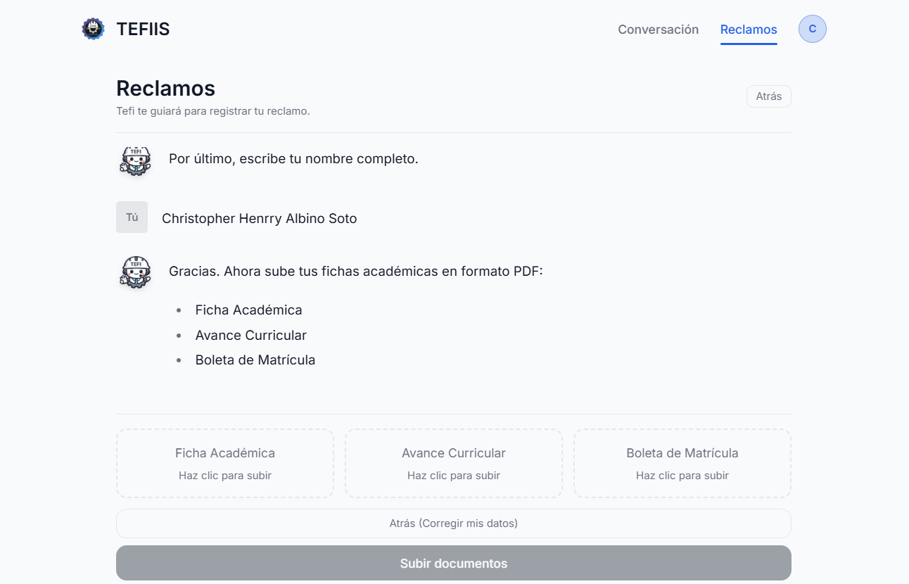

# Diseño de la interfaz

Sección 5 del informe de la Entrega 1 (SW708, equipo 2).

La interfaz se documenta, no se califica por su aspecto. Para los tres flujos que más se usan anotamos qué valida la interfaz y qué valida el dominio. La regla que seguimos: **la interfaz valida la forma, para que el usuario no espere; el dominio valida el significado, porque cualquiera con un token puede llamar a la API sin pasar por la interfaz.**

TEFIIS tiene dos interfaces:

| Interfaz | Quién la usa | Dónde vive |
|---|---|---|
| Aplicación de estudiantes | Estudiantes de la FIIS | Este repositorio, en `src/` (React 19, TypeScript y Vite) |
| Panel del Tercio | Miembros del Tercio | Repositorio `sistema-admin` |

## Pantallas de la aplicación de estudiantes

**Conversación con Tefi.** Es la pantalla de inicio. El estudiante escribe su duda y Tefi responde a partir de los reglamentos de la facultad.

**Menú de reclamos.** Desde aquí se inicia un reclamo nuevo o se consultan los anteriores y su estado.

**Registro del reclamo.** Tefi guía el registro paso a paso, como una conversación: carrera, código UNI, nombre y después los documentos del SIGA.

## Flujos principales

### Presentar un reclamo

Lo inicia el estudiante.

1. Pide un código con su correo `@uni.pe` y lo ingresa; recibe una sesión de 24 horas.
2. Declara su carrera, su código UNI y su nombre, y sube su ficha académica y su avance curricular del SIGA (la boleta es opcional).
3. Elige la categoría, los cursos y secciones a retirar o matricular desde el catálogo, escribe la descripción y adjunta un PDF de evidencia.
4. Envía. La API valida y devuelve el número `REC-2026-NNNN`.
5. Recibe la confirmación por correo y sigue el estado de su reclamo en la aplicación.

### Consultar a Tefi

Lo inicia el estudiante, con sesión o sin ella.

1. Escribe su pregunta en el chat.
2. La API la envía a Gemini con búsqueda en los reglamentos indexados.
3. Tefi responde con texto, tablas y fórmulas.
4. Si hay sesión, el turno se guarda para auditoría. Si el Tercio activó el modo almuerzo, la API responde 503 y la aplicación le ofrece registrar su reclamo.

### Resolver un reclamo

Lo inicia un miembro del Tercio, desde el panel.

1. Inicia sesión en el panel con su cuenta de Firebase.
2. Abre el reclamo y revisa sus documentos, que se muestran con URL firmadas.
3. Cambia el estado: `EN_REVISION`, `ACEPTADO`, `ACEPTADO_PARCIALMENTE`, `RECHAZADO` o `MATRICULADO`.
4. Registra qué cursos-sección se matriculan o se retiran de verdad (la rodaja vertical de la sección 6).
5. Escribe la respuesta y la envía por correo; queda en el historial del reclamo.

## Frontera entre la interfaz y el dominio

| Lo valida la interfaz (forma) | Lo valida el servidor (significado) |
|---|---|
| El correo termina en `@uni.pe` o está en la lista de excepciones. La copia de esa lista en [src/utils/correosPermitidos.ts](../../sistema-reclamos/src/utils/correosPermitidos.ts) solo evita un viaje inútil. | El servidor vuelve a decidirlo con su propia lista (`correoPermitido` en `server.js`): la copia de la interfaz no manda. |
| El botón para verificar el código no se habilita con menos de 4 caracteres. | El código coincide, no venció (5 minutos) y no se superaron 5 intentos fallidos. |
| El código UNI tiene 7 u 8 dígitos y una letra final ([useReclamos.ts](../../sistema-reclamos/src/features/admin/hooks/useReclamos.ts)). | Hoy no se vuelve a comprobar: la API guarda el código tal como llega, y un cliente modificado podría enviar cualquier valor. |
| Categoría y descripción no están vacías, y los cursos se eligen de un catálogo en lugar de escribirse. | La ventana de reclamos está abierta. Cada curso existe en el catálogo y la sección le pertenece; los que no cumplen se descartan sin avisar al estudiante, y cada lista se corta en 30 cursos. El nombre del curso se toma del catálogo y no del cliente. Un reenvío idéntico en 10 minutos no crea otro reclamo. |
| El archivo es un PDF (tipo y extensión). La pantalla anuncia el tope de 10 MB, pero no lo comprueba. | El servidor vuelve a exigir PDF y corta la subida por encima de 10 MB (evidencia) o 15 MB (ficha, avance y boleta). La evidencia adjunta pertenece al estudiante de la sesión. |
| El panel solo ofrece los estados válidos y oculta los botones de un reclamo `MATRICULADO`. | El estado pertenece a la lista cerrada de seis, y un reclamo `MATRICULADO` no puede cambiar de estado (409), aunque alguien llame a la API a mano. |
| Las listas de cursos resueltos se arman en el panel. [verificar en sistema-admin qué valida] | Cada lista tiene como máximo 40 cursos, cada curso trae código y sección (que se normalizan a mayúsculas) y el historial conserva 50 entradas con autor y fecha. |

Una observación honesta: de la columna derecha, solo la última fila vive hoy en `backend/dominio/`. Las demás reglas de significado están dentro de los handlers de `server.js`, mezcladas con HTTP. Cumplen su función en producción, pero no se pueden probar sin levantar el servidor; moverlas al dominio es parte de la partición en módulos de la semana 9.
